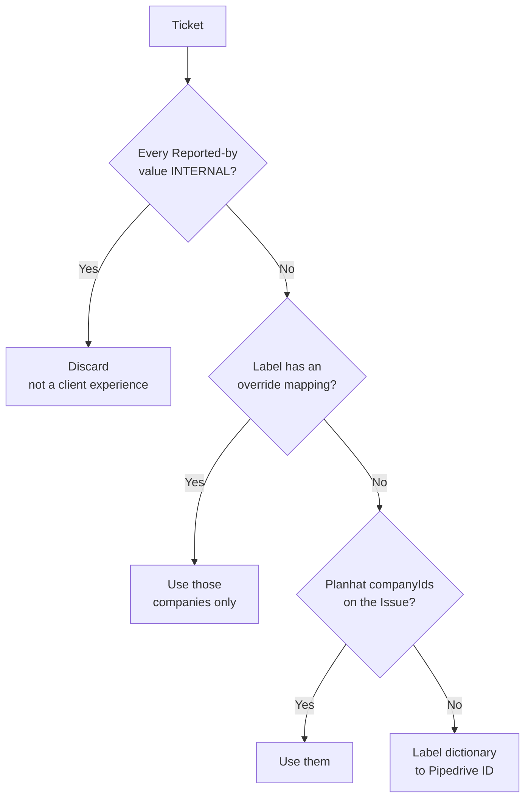
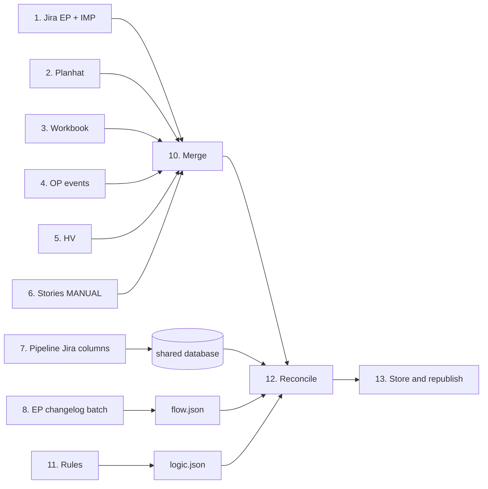

# Client Ledger — Methods, Sources & Refresh Runbook

2026-09-22 · @Prod1

## What this is

**The Client Ledger artifact is the source of truth.** Every number it shows is defined by a rule in its own Logic registry — 201 rules, stored beside the page as `logic.json` and embedded in the page as its seed — and computed from data the artifact stores as JSON. This document explains that registry, the sources behind the data, where the data is stored and how it is refreshed. Where this document and the registry disagree, the registry wins and this document is corrected.

The working rule: **change the rule first, rebuild second, record third.**

1. A weight, cap, threshold or window is changed on the Logic tab. The page recomputes in front of you, the impact panel says what moved, and *Save into this artifact* writes it into `logic.json`, so it travels with every copy of the page.
2. A rule the page cannot compute from stored data — a status map, an extraction filter, a scope — is changed in the registry and in the build script in the same sitting, then the extract is re-run and republished.
3. Either way, a row goes into the change log below. A change made only in page code is lost at the next rebuild and cannot be reviewed by anyone who did not write it.

The Ledger merged two earlier dashboards and turned them client-side up. Four more feeds have joined since:

| Feed | What it contributes | As of |
| --- | --- | --- |
| Client Bug Radar | 49 companies, 84 open bugs, 39 incidents, the Health Score model | 17 Sep 2026 |
| Delivery Timeline | 650 stories delivered or in progress across 2026, six value lenses, 11 teams | 16 Sep 2026 |
| Jira OP project | 271 event editions: the deadline layer on both timelines, and each client's risk window | 21 Sep 2026 |
| Jira HV project | The Hyve dedicated team: 54 delivery items and 21 open bugs, all attributed to Hyve Group Plc | 21 Sep 2026 |
| Must-Have Product Pipeline Ledger | 18 committed items, imported from Confluence and now held in the artifact's shared database | Page of 18 Sep, migrated 22 Sep |
| Jira EP changelog | A 64-issue flow sample: every status transition and the time spent in each state | 22 Sep 2026 |

Both predecessors are untouched and still live. The Ledger holds a copy of their data, not a link to them.

## Where everything is stored

**Nothing the page shows is pulled from a source when it opens.** Every pull is a deliberate run whose result is stored as JSON with a date on it; the page reads that JSON and does arithmetic on it. This is rule `src-stored-json`.

| What | Where it lives | Written by | Read by |
| --- | --- | --- | --- |
| Companies, bugs, incidents, events, stories | Inline JSON in the page (`window.LEDGER`) | The refresh build | Every tab |
| The Hyve dedicated team's items | Inline JSON in the page (`window.HYVE`) | The refresh build | Every tab, switchable with `hv-exclude` |
| The logic registry, 201 rules, and the log of every save | `logic.json` beside the page; the same rules embedded as the page's seed. Each save appends who, when and what changed to its `log` (`lg-history`) | *Save into this artifact* on the Logic tab, or a rebuild | Every calculation. The page loads `logic.json` over the seed when it opens |
| The pipeline ledger: its items, the column schema and the history of every change to them | The artifact's shared database: `config/pipeline` and one `pipeline/<id>` document per item, schema 2. Each document carries its own history in `h`, and a removed item stays with `deleted` set (`pp-history`) | Anyone who can interact with the artifact, through the item form or a table cell on the Pipeline tab; Claude for the Jira columns | The Pipeline tab; investment, the risk matrix and promise-versus-show on the Ledger and Timeline tabs, which read live items only |
| The flow extract: every transition, the time in each state, the flags, the summary and the checks | `flow.json` beside the page | `flow/compute_flow.py`, run over one compacted changelog per issue | The Flow tab, and the flow line on story cards and pipeline records |

**What the page computes when it opens:** liability, investment, exposure, the quadrant, the risk matrix and its red and amber flags, promise-versus-show, the team roll-ups and the month × team grid. All of it is arithmetic over stored data with the current rule values, which is why a changed rule shows its effect instantly and the impact panel can compare before and after.

**What it never does when it opens:** call Jira, Planhat, Google Drive or Confluence.

`flow.json` carries every transition of every in-scope issue, so a new status map or a different threshold can be recomputed from the file without a new Jira pull. Two flow figures are recomputed in the page from stored rows rather than read from the summary: the business-days switch (`fl-business-days`) picks between the two stored duration sets, and the rework ladder is recounted from the stored loop events when the click-through threshold (`fl-clerical-bounce`) changes.

## Access: what can actually be re-pulled

**Everything except the 2026 story feed now pulls through a connector.** Every row was tested live between 18 and 22 Sep 2026.

| Source | Reachable now | How | What it still needs |
| --- | --- | --- | --- |
| Jira EP (bugs) | **Yes** | Atlassian connector, `read:jira-work` | Nothing |
| Jira IMP (incidents) | **Yes** | Same connector | Nothing. MTTA, MTTR and SLA come from the changelog (Source 2); that pull is not built yet |
| Jira OP (event dates) | **Yes** | Same connector, live since 21 Sep | Nothing |
| Jira HV (Hyve dedicated team) | **Yes** | Same connector, live since 21 Sep | Nothing |
| Jira EP changelog (flow) | **Yes** | Same connector, `expand=changelog`, one read per issue | The scheduled batch over the full scope, with the changelog paged (Source 10) |
| Confluence OPKL (definitions, Planhat field reference) | **Yes** | Atlassian connector, Confluence read scopes | Nothing |
| Susan's Customer & Event workbook | **Yes** | Google Drive connector | Nothing |
| Planhat (tier, health, factors) | **Yes** | Planhat connector, live since 21 Sep | Nothing |
| Pipeline ledger | **Lives in the artifact** | Edited on the Pipeline tab; shared database | Its Jira columns are refreshed on request |
| Delivery Timeline stories | **No** | Inherited from the existing artifact | The generator that built it, documented |
| incidents.expoplatform.tools | **Not a source** | A second rendering of the IMP project | Nothing — see Source 6 |

The Atlassian connection is authenticated as **Ajay Singh**, so every Jira and Confluence pull inherits his permissions. A refresh run by someone else may legitimately return different rows.

### The consequence worth internalising

Connectors make every refresh repeatable. They do not make the Ledger live. Each feed is pulled on request and stored with its date — bugs 17 Sep, delivery 16 Sep, events and Hyve 21 Sep, the pipeline's Jira columns and the flow sample 22 Sep — so **every figure reads as of its stamp, not as live**. The drift is measurable and fast: one day after the 17 Sep snapshot, two tickets had closed and a third had been raised. The table under **Known gaps** records what moved.

## Source 1 — Jira EP, the bug feed

**The JQL the dashboard used to print returned 324 issues, not its own 84.** Since 22 Sep 2026 the Method & sources tab links the closest query Jira can express instead, and says on the card why even that returns 76.

The query that used to be printed:

```
project = EP AND issuetype = Bug AND statusCategory != Done
AND (cf[10145] is not EMPTY OR cf[12190] is not EMPTY)
```

Measured live on 18 Sep 2026, that returns **324** issues. The narrowing that gets to 84 lives in the extraction script, not in the JQL: tickets whose *every* Reported-by value is INTERNAL are discarded, and tickets whose labels resolve to no active Planhat company are dropped.

| Query | Count |
| --- | --- |
| The old printed JQL | 324 |
| Reported by is not empty | 324 |
| Affected clients is not empty | 30 |
| Reported by excluding INTERNAL | 66 |
| Closest reproducing JQL (below), now the one linked | 76 |
| Rows in the dashboard | 84 |

The closest JQL that can be written in Jira alone (registry rule `jql-ep`):

```
project = EP AND issuetype = Bug AND statusCategory != Done
AND (cf[10145] != "INTERNAL" OR cf[12190] is not EMPTY)
```

It returns 76, not 84, and the gap is genuine rather than an error. Jira's `!=` drops a ticket if *any* Reported-by value is INTERNAL; the rule is that a ticket is dropped only if *every* value is. A ticket labelled `[INTERNAL, DLG]` belongs to DLG and the JQL wrongly excludes it. **JQL cannot express the rule** — the discard must happen in the extraction step.

### Fields

| Field | ID | Shape | Use |
| --- | --- | --- | --- |
| Reported by | `customfield_10145` | Multi-select, array of `{value}` | The attribution signal |
| Affected clients | `customfield_12190` | Multi-select, array of `{value}` | Shown, never scored |
| Pipedrive Company ID | `customfield_12108` | String, e.g. `"81808"` | The join key |

[Open the closest live JQL](<https://expoplatform.atlassian.net/issues/?jql=project%20%3D%20EP%20AND%20issuetype%20%3D%20Bug%20AND%20statusCategory%20!%3D%20Done%20AND%20(cf%5B10145%5D%20!%3D%20%22INTERNAL%22%20OR%20cf%5B12190%5D%20is%20not%20EMPTY)>)

## Source 2 — Jira IMP, the incident feed

**The noise filter is settled.** It was reconstructed on 18 Sep 2026 by diffing all 55 IMP issues in the 180-day window against the dashboard's 39, and every one of the 16 differences is explained.

The governing definition comes from the [Incident Management Process](https://expoplatform.atlassian.net/wiki/spaces/engineering/pages/1153204232/Incident+Management+Process): incidents are **ongoing problems on production that affect our clients**. Everything excluded below fails that test.

| Excluded | Count | Rule |
| --- | --- | --- |
| Grafana / monitoring alerts | 8 | `reporter = System`, every summary starts `[Grafana]: [FIRING:1]` |
| Explicit test tickets | 3 | `[TEST] another test ticket`, `[TEST] Dummy ticket`, `test DevOps incident` |
| Uptime-monitoring noise raised by humans | 2 | `Uptime robot - noise`, `UptimeMonitoring notifies about issues` |
| Non-production environment | 1 | IMP-322 is tagged `alpha2` — not production, so not an incident |
| Raised after the snapshot | 1 | IMP-323, created 17 Sep 13:25, after the pull |
| Not a production service disruption | 1 | IMP-319, Cancelled — an App Store availability setting |
| **Kept** | **39** | Matches the dashboard exactly |

The reproducing query (registry rule `jql-imp`). The environment and date tests still happen in the extraction step, as with the bug feed:

```
project = IMP AND created >= -180d
AND reporter != "System"
AND summary !~ "Grafana"
AND summary !~ "TEST"
AND summary !~ "Uptime"
```

That returns 42. Dropping the non-production ticket, the post-snapshot ticket and the App Store one gives the dashboard's 39. **Nothing in the dashboard's 39 is dropped by this rule** — it is a clean superset, which is what makes the reconstruction trustworthy.

`reporter = System` alone accounts for 8 of the 16 and is the single highest-value clause. The AI-Powered Incident Analyzer also labels IMP tickets on creation (`ai-analyzed`, `ai-valid`, `ai-duplicate`, `ai-already-fixed`, `ai-needs-info`); `ai-duplicate` is a candidate future exclusion but was not used here.

### Severity

Severity is **the ticket's priority**, mapped to SEV levels with published SLA targets:

| Severity | Jira priority | Response | Time to resolve | Post Mortem |
| --- | --- | --- | --- | --- |
| SEV0 Critical | Urgent | <30 min, 24/7 | 2–4 hours | Required, 3 days |
| SEV1 High | High | <1 hour, 24/7 | 4–8 hours | Required, 7 days |
| SEV2 Medium | Medium | 8h business hours | 8–24 hours | Optional |
| SEV3 Low | Low | Next business day | 2–3 business days | Not required |

### Computing MTTA, MTTR and SLA breach from Jira

**This works, and it was proven on a real ticket.** It can replace the hand-typed stats card; the pull is not built yet, so the Incidents tab still quotes the incident tool's 17 Sep card as a dated baseline (see Source 6 and the open questions).

The obvious route fails: **`resolutiondate` and `resolution` are `null` on every IMP ticket**, including ones whose status is Done. The workflow closes by status transition without setting a resolution, so the standard field is empty. `updated` is no substitute — it moves on any later edit.

The working route is the **changelog**, available via `expand=changelog` — the same technique the Flow tab now uses for EP (Source 10):

| Metric | How | Source |
| --- | --- | --- |
| Detection | Ticket `created` | Field |
| **MTTA** | Until `customfield_12074` **Incident manager** is first set | Changelog |
| **MTTR** | Until the **last** transition into a done status | Changelog |
| SLA breach | Compare each against the SEV target above | Computed |
| Severity | `priority` | Field |

Worked example, IMP-321 (Urgent, so SEV0: respond <30 min, resolve 2–4 h):

| Event | Timestamp | Elapsed |
| --- | --- | --- |
| Created | 16 Sep 12:07 | — |
| Incident manager set | 16 Sep 19:45 | **MTTA 7h 38m** — breached |
| Closed (final) | 18 Sep 14:51 | **MTTR 2d 2h 44m** — breached |

**Take the last done transition, not the first.** IMP-321 went Testing → Done → Testing → Done; using the first would understate MTTR by a day.

**Automation for Jira sets the Pipedrive Company ID within seconds of creation** — 4 seconds on IMP-321 — and the AI Bug Analyzer labels the ticket about a minute later. Attribution is automated at the source, which is why the incident side joins so cleanly.

| Property | Value |
| --- | --- |
| Window | Created in the last 180 days |
| Attribution | Override labels first, then the Pipedrive Company ID field, then the label dictionary |
| Cancelled incidents | Kept and shown hollow; excluded from the live count and from liability |
| Unattributed | 8 of 39 carry no client and cannot appear in any client-level view |

The attribution order differs from the bug side — incidents try override labels *before* the Pipedrive field. This is per the OPKL design guide, not an inconsistency to be tidied away.

## Source 3 — Delivery Timeline, the 2026 story feed

**This is the weakest link in the chain and the one to fix first.** The 650 stories were inherited from the existing Delivery Timeline artifact. The generator that produced them — the Jira query, the AI summarisation prompt, the theme classifier — is not documented anywhere, including here. Until it is, this feed cannot be refreshed; it can only be re-inherited.

| Property | Value |
| --- | --- |
| Volume | 650 stories, 560 shipped, 90 in progress |
| Period | Jan–Sep 2026, bucketed by delivery month |
| Teams | 11 |
| Themes (lenses) | AI & Automation, Cost & Labour Reduction, Revenue & Monetisation, Data Insight & Trust, Integrations & Platform, Experience & Engagement |
| Generated | 16 Sep 2026; delivery dates re-read from Jira 20 Sep |

### The fields that matter, and their trust level

| Field | Meaning | Written by |
| --- | --- | --- |
| `k`, `link` | Jira key and URL | Jira |
| `sf`, `mo`, `q` | Shipped or in progress, delivery month, quarter | Jira |
| `team`, `bv`, `rg` | Team, business value, Run/Grow/Transform | Jira |
| `s`, `pr`, `wy`, `oc` | Summary, problem, why, outcome | **AI, from the ticket and its linked spec** |
| `lens`, `pa` | Theme and product area | **AI classification** |
| `cf` | Confidence in the AI text: High 418, Medium 140, **Low 92** | AI self-assessment |
| `cl` (`tags`) | Client tokens — the only link to a client | Jira Reported by, `customfield_10145` (corrected 24 Sep 2026: not labels) |

The prose on every story card is AI-written, never invented from nothing, but 92 stories are flagged low confidence and are marked as such wherever they appear. Treat a low-confidence summary as a pointer to the ticket, not as a statement of fact.

**Only 61 of 650 stories carry a client label.** 109 are INTERNAL and 483 carry no label at all. That single number is why the investment axis is thin, why investment is a count rather than person-days (decision D1), and why the platform band exists. The Hyve dedicated team's items are a separate population and are never added into the 650 (`hv-not-in-650`).

## Source 4 — Planhat, the company master

Planhat decides which companies exist in the Ledger: **Phase = Active**. It is read live through the **Planhat connector since 21 Sep 2026**, so it no longer needs a hand export. Two records in that set are not ordinary customers and both need a decision:

| Record | Issue |
| --- | --- |
| `Informa` (82918) | A **group parent**, not a customer in its own right. The workbook excludes it; the Ledger counts it. |
| K5 GmbH (67819) | In Jira and the contract sheet but **no longer Phase = Active**, so it has no tier, health or computed factors. Carried anyway, in the No tier row of the risk matrix. |

Fields read:

| Field | Used for |
| --- | --- |
| Sales Tier | The tier bands on every view, the tier rows of the risk matrix, a pipeline item's tier through its Driver |
| Health | The 0–10 badge (the badge rounds; 2.52 shows as 3) |
| Incident Score, Open Client Bug Weight, Client Bug Score | The quality penalty |
| Health Factors Breakdown | The plain-language explanation; only its first paragraph is shown |
| CSM score, RM score, Sentiment | Context on the client record |
| Owner, Renewal | Account columns |

**Revenue is deliberately not read.** Won TCV and contract value were removed from the dashboard on 21 Sep 2026 and are not held in the page.

### The four fields Planhat writes back nightly

These are produced by an n8n job, overwritten every night, and **must never be edited by hand**:

| Item | Detail |
| --- | --- |
| Workflow | `jpuksPy0UTJJHO6D` — "PH: Health Score - Bug & Incident Factors (nightly)", Planhat folder |
| Schedule | Trigger reads 03:10, but the workflow has no timezone of its own, so runs start at **01:10 UTC** |
| Inputs | Planhat companies, Planhat deals (for the renewal anchor), Planhat Issues from every synced Jira project (currently EP and Hyve — no project filter), and Jira IMP read directly |
| Outputs | Incident Score, Open Client Bug Weight, Client Bug Score, Health Factors Breakdown |
| On failure | The four fields keep yesterday's values and the Health Score keeps computing from them. Nothing breaks visibly; the data just ages. An Error Trigger emails the owner. |
| Downstream | Weekly Customer Health Digest `3hyLMUGOn21IctQt` reads the same three fields |

### If the connector is unavailable

The Planhat API is fully specified as a fallback. A token is a live credential with read and write access to the whole customer book, so it must not be pasted into a chat session; the connector exists precisely so the platform holds the credential rather than a person or a document.

| Item | Value |
| --- | --- |
| Auth | `Authorization: Bearer {{apiAccessToken}}`, a static token belonging to a **Private App** (Settings → Private Apps) |
| Rate limit | 200 calls/minute soft; 150 req/s hard, bursts to 50 parallel |
| Bulk upsert | 5,000 items per request maximum |
| Analytics host | `analytics.planhat.com` — separate, not rate-limited the same way |
| Docs | [API reference](https://www.planhat.com/developers/api/introduction) · [Authentication & limits](https://www.planhat.com/developers/api/authentication-limits) |

### A discrepancy to resolve

The [Planhat Field Reference](https://expoplatform.atlassian.net/wiki/spaces/OPKL/pages/2155216902/Planhat+Field+Reference+Company+Asset+Deal+Levels) does **not list** several fields the Ledger depends on:

| Field the Ledger reads | In the field reference? |
| --- | --- |
| Incident Score | No |
| Open Client Bug Weight | No |
| Client Bug Score | No |
| Health Factors Breakdown | No |
| Sales Tier | No |
| Health (`h`), CSM score (`csmScore`), RM Score | Yes |
| Jira Bug Count, Jira Incident Count | Yes, both read-only |

The reference was refreshed on 17 Sep 2026 from live API metadata, so either the four nightly-written fields sit outside the Company custom-field set it enumerates, or the page is incomplete. **This matters more than it looks**: renaming any of those four silently freezes every company on yesterday's value, and a field reference that does not list them cannot protect against that.

## Source 5 — Susan's Customer & Event workbook

This workbook is where the **Pipedrive Company ID becomes the join key of record**. Everything else in the Ledger is joined through it, so this sheet is load-bearing well beyond the columns it supplies. **It is used for one thing: the Pipedrive Company ID.** Contract value and currency are not read, and event dates come from the OP project, not from this sheet.

| Property | Value |
| --- | --- |
| File | `Customer & Event Data, August 2026.xlsx` — an .xlsx, not a native Sheet |
| Owner | s.merola@expoplatform.com |
| Last modified | 16 Sep 2026 |
| Tabs | Version History, Overview (methodology), Customers, Events, Line Items |
| Coverage | 48 of the 49 Planhat-Active customers |
| Access | **Google Drive connector, live since 18 Sep 2026** |

### How the sheets link — in the workbook's own words

| Link | Rule |
| --- | --- |
| Customer ID | **Pipedrive Company ID = Planhat's `externalId` on Company**, because Planhat syncs from Pipedrive. Not a Planhat-only number. |
| Planhat ID | Planhat's own internal record ID, carried alongside for direct lookups |
| Jira Ticket | The OP-project ticket for that event, resolved via **Planhat Asset → `sourceId` → Jira issue ID** — an exact 1:1 match, not a name or date guess |
| Contract matching | Each event's Jira ticket carries a Pipedrive deal link, cross-checked against the Planhat Deal's `externalId` |

### Caveats, for anyone reading the sheet directly

| Column | Reality |
| --- | --- |
| Contract Value | **Sum of all concurrent Closed-Won deals**, not one contract. 13 customers have more than one deal covering today. Not read by the Ledger. |
| Auto-Renewal, Price Escalator | **Not customer data.** Filled from the ExpoPlatform contract template's standard language. Flagged yellow in the sheet. |
| Notice Period, Minimum Commitment, Change-of-Control | **True placeholders.** They exist only in signed contract PDFs, unreviewed. |
| Number of Events, Contracted Value | Live COUNTIF/SUMIF formulas, not typed values |

Because the workbook is maintained by hand, a client renamed here but not in the Jira label dictionary silently loses its delivery and bug attribution. That failure is invisible on the dashboard — the client simply shows a quiet row.

## Source 6 — The incident tool and the OPKL guides

### incidents.expoplatform.tools

**This is not a source.** The tool reads the same IMP project the Ledger already pulls, so its figures are a second rendering of Jira, not independent data. Compute them from the changelog instead — the method is in Source 2.

The Incidents tab still carries the tool's card as it stood on 17 Sep, typed in by hand and stale by construction. It is a baseline to check the changelog computation against, not a figure to quote:

| Measure | Value | Target | Breach |
| --- | --- | --- | --- |
| New incidents | 7 (up 40% on prior 30 days) | — | — |
| Open now | 1 (IMP-321 Busworld Plaza, Urgent) | — | — |
| Incident MTTA | 18h 47m | 2h 55m | 50% |
| Incident MTTR | 1d 21h | 6h | 60% |
| Urgent SLA | 0 of 2 within SLA | — | — |
| Bug MTTA / MTTR | 8h 17m / 4d 17h | — | — |

### The Confluence definitions

These are readable through the connector and are the authority for the Health Score model. Where the Ledger and these pages disagree about the model, the Confluence pages win and the registry's Health model rules are corrected.

| Page | Holds |
| --- | --- |
| [Health Score — Bug and Incident Factors](https://expoplatform.atlassian.net/wiki/spaces/OPKL/pages/2015920131) | The three factors, caps, decay, attribution, the nightly job. Reviewed 14 Sep 2026, author Iurii Drozdov |
| [Health Score Model — Live Configuration](https://expoplatform.atlassian.net/wiki/spaces/OPKL/pages/2140962823) | The rest of the model: CSM score, RM score, Sentiment, Days since last contact |
| [Client Data Journey hub](https://expoplatform.atlassian.net/wiki/spaces/OPKL/pages/2090074114) | The surrounding data model |

## Source 7 — Event dates, Jira OP project

Event dates are live and re-pullable. `project = OP AND issuetype = 10080` returns 719 event tickets; the dashboard carries the 271 that end on or after 1 January 2026. Since 22 Sep 2026 each client's next dated show also sets its risk window (`rk-window-source`).

| Measure | Count |
| --- | --- |
| Event tickets in the project | 719 |
| Carried here, ending 2026-01-01 or later | 271 |
| Already ran in 2026, so comparable against delivery | 107 |
| Still to come | 168 |
| Resolving to a ledger client | 203 |
| Carrying no client token at all | 33 |

**Two date fields, and it matters which.** `customfield_10015` is the event start; `duedate` is its last day. Verified on OP-20276, which reads 16 to 18 March 2027 in both Jira and the workbook. Taking `duedate` as the event date would place a three-day show two days late and shorten every lead-time figure by the length of the show.

**Not every ticket of this type is a show.** The summary prefix classifies it: no prefix is a show (261), `(COMMUNITY)` is a year-long platform engagement (4), `(OTHER)` is a continuous service such as a webshop (5), `(EP LITE)` is a light deployment (1). The nine community and engagement records run between 364 and 1,099 days, so a countdown against one is meaningless. They appear on the grid, are excluded from every deadline figure, and their clients are read by the always-on risk rule instead (`rk-no-show-clients`).

**Next show** (`ev-next-show`): the client's first show whose end date is today or later; the countdown is days from the events snapshot (21 Sep) to its start. 28 of the 49 clients have one; 21 have no dated show.

**Attribution (since 26 Sep 2026) is by the Pipedrive Company ID on the ticket (`customfield_11906`)**, set on every event ticket; see the change log. Before that it was by label, and the labels are looser than the bug ones: 242 of 271 carry a client token and 55 distinct tokens appear. ADS alone has three (`ADS`, `ADSGroup`, `adsgroup.org.uk`), and `DWTC` and `DXBLive` are the same client. The alias table in the registry resolves 203 events. The rest stay unresolved rather than guessed: `premiereeventsbyinforma` and `InformaCosmoprofNA` need a decision on which Informa entity, `CONNECTOman` is probably Connect but is not evidenced, and eight tokens have no ledger client at all. `SusanTest` is test data and is dropped.

**Three dates disagree with the workbook, and one event is impossible.** OP-18706 IATF 2027 reads 5 to 11 November in Jira against 1 to 5 November in the workbook; OP-16585 and OP-16533 are each about two weeks apart between the two sources. OP-12907 Arbeitsschutz 2030 has a start date two years after its end date. Jira is treated as the source of truth and each disagreement is carried on the event row.

## Source 8 — Jira HV, the Hyve dedicated team

Joined 21 Sep 2026. A dedicated team standing up work for one client, formed after Q1 2026. Call it **the Hyve dedicated team**, never "the HV project", in anything a reader sees (`hv-naming`): naming it a project invites a comparison with EP, which is a platform serving 49 clients.

| Property | Value |
| --- | --- |
| Query | `project = HV AND issuetype in (Story, Bug) AND created >= "2026-04-01"` |
| Scope | Story and Bug at hierarchy level 0: 153 of the project's 517 issues. Sub-task (166), Defect (95), Task (55), Feature Request (2) and Epic (24) are out |
| Attribution | **Project membership.** Every item belongs to Hyve Group Plc, Pipedrive 4121. Only 3 of 175 HV items carry a Hyve label and 8 a Pipedrive ID, so the normal route would find almost nothing |
| INTERNAL discard | **Switched off.** 36 of 175 HV items carry Reported by = INTERNAL; the EP rule would delete a fifth of the team's work |
| Delivered | **Status = Done.** Not statusCategory = Done: Rejected is a *status* here, and `resolution != Rejected` filters nothing. 30 of 95 Done-category items sit in Rejected |
| In scope today | 32 stories shipped, 22 in delivery, 29 in the backlog, 11 rejected; 21 bugs open, 26 closed, 12 rejected |
| Bugs | An open HV bug joins Hyve's liability exactly like an EP client bug. A closed one counts nowhere |
| Pre-team bugs | Three bugs raised in March 2026 are still open (HV-132, HV-178, HV-134). Excluded by default; `hv-preq2-bugs` puts them back |
| The switch | `hv-exclude`. With HV counted, Hyve tops both axes — investment 75 against IMEX's 17, liability 67.8 against Frankfurter Buchmesse's 66.5. Excluded, Hyve reads 21 and 12. It is not like-for-like with the other 48 rows while counted |
| Enrichment | None. No AI summary, theme or confidence rating; every HV card says so |

## Source 9 — The pipeline ledger

The committed must-haves for the months ahead. Imported from the Confluence page [Must-Have Product Pipeline Ledger](https://expoplatform.atlassian.net/wiki/spaces/P2/pages/2155872263/Must-Have+Product+Pipeline+Ledger) as it stood on 18 Sep 2026; that page now points to the artifact. **The artifact's shared database is the source of truth for what we have committed to build** (`pp-source`): add or change an item on the Pipeline tab and everyone with access sees it at once, and the change is recorded with who made it and when (`pp-history`).

### Schema 2, since 22 Sep 2026

| Column | What it holds | Rule |
| --- | --- | --- |
| Month, Area, Status | Normalised so the ledger can be totalled; the owner's original wording is kept on every row | `pp-normalise` |
| Raised by (was Owner) | Whoever wrote the item down. Kept on the row; **enters no total** | `pp-team-unit` |
| Jira, Feature, Impact, Priority, Dependencies, Estimate, Notes | As imported | — |
| Why | **One line, hard limit 140 characters.** The editor enforces it | `pp-why-one-line` |
| Rationale | The long form. The old *Why it matters* text moved here verbatim on migration; Why started empty | `pp-why-one-line` |
| Driver | Who the item is for: a client from the Planhat active list, or Platform | `pp-driver` |
| Team (no Jira ticket) | Needed only where the row has no ticket, or the ticket carries no team | `pp-team-source` |
| *Team* (derived) | From the Jira ticket's team field, `customfield_10001`; else the row's own Team; else badged *no team* and counted in the unassigned line | `pp-team-source` |
| *Tier* (derived) | The Driver's Sales Tier; blank for Platform | `pp-driver` |
| *Days, Jira status, Jira due, Logged, Flags* (derived) | Parsed from the estimate, or read from Jira on request and dated | `pp-estimate-parse`, `pp-jira-derived`, `pp-drift` |

**Driver was pre-filled only where the row itself names a client** (`pp-driver-prefill`): DLG Markets GmbH (81808) on the five rows whose Why read "DLG commitment", and IMEX (26874) on EP-57221 ("Critical for IMEX") and EP-57297 (Impact: "Currently a major blocker for IMEX."). The quoted text is stored on each pre-filled row and shown in its form. The other eleven are badged *Driver not set*.

### Refresh of 28 Sep 2026

The product owners kept editing the Confluence page after the import, so on 28 Sep it was read again (with its Jira keys, which the markdown export drops) and folded in by `tools/pipeline_pull.py`: **26 items, 8 new** (EP-56770 FESPA exhibitor manual, EP-56742 ACI invoicing, EP-29630 permission matrix, EP-55779 / EP-57914 / EP-57918 the IMEX AI Search steps, EP-57482 Lead Capture Pro, and Group Registration with no ticket and no month), the Iyzico row gained its ticket EP-55900 and its reason, EP-56915's estimate went from 15-20d to 16d and EP-48716 moved from October to November. Every item's Jira columns were read again. Key, month, status, area, priority, owner and estimate follow the page; prose is only filled where the ledger had none, because the first import condensed the page's wording. A month range counts at its last month, the promise date (`October-November 2026` → November). Drivers were pre-filled where the row names the client: FESPA, IMEX (three), and ACI, matched to the only ACI on the Planhat active list, Airports Council International - ACI Asia-Pacific (check this one). Raw pulls: `data/pipeline/raw/`.

### Status, target show and funding (28 Sep 2026)

- **Status follows Jira** wherever the item has a ticket (`pp-status-jira`): every view shows the ticket's own status name (e.g. *Ready for release*, *In testing*, *Ready to start*) and places it in the board column its status maps to (Open, Ready to start, Backlog → Planned; In testing → In Testing; Ready for release → Ready for Release). The item form shows it read-only; change it in Jira. The stated status only counts for items with no ticket. Every Jira refresh (any viewer, every 4 hours, and *Pull delta now*) re-reads every must-have ticket and updates its Jira columns, so the ledger matches every board. The *status differs from Jira* flag is gone: it cannot happen any more.
- **For show** (`forShow`, an OP key): the show an item is promised for when it is not the client's next one. The after-the-show check uses it, and an item with a target show is not flagged overdue on its Jira due date. The four open IMEX items (EP-57297, EP-55779, EP-57914, EP-57918) are for **IMEX Frankfurt 2027** (OP-17374, 18-20 May 2027) with delivery this year (owner, 28 Sep 2026).
- **Funded** (`funded`: Yes, Part, No): shown as a badge and a filter. Funded on 28 Sep 2026 (owner): **all Hyve dedicated team work** (every HV item; shown on the Hyve bar and every HV tag), the **IMEX AI Search project** (EP-55779, EP-57914, EP-57918) and **Vinexposium's required custom filters** (EP-56915).

### The Board (default since 28 Sep 2026)

The Month × team grid drew every team × month × client cell, mostly empty, so the pipeline did not fit on a screen. The **Board** replaces it as the default: one column per month (September to the last month with an item, plus *No month yet*), each item a card with its key, status, feature, client (with tier) or *No client set*, team, days, and flags (after the client's show, overdue in Jira, Jira's status where it differs, shipped). Each month column shows its item count and person-days and marks the shows of the clients on the ledger that fall in it. Columns can be switched to Client (with the client's next show), Team or Status. Above it, five figures (items, committed effort, this month's and next month's load, items due after the client's show) and one **Needs attention** line whose parts filter the board. The grid and the table stay one click away; the effort charts sit under the board.

### What the tab shows

- **Effort by team** replaces effort by owner, with an *unassigned* line beneath it. Kavi is a PO; the owner roll-up measured who filled in the form.
- **The month × team grid is the default view** (`pp-default-view`); the table is one click away, and a viewer's choice of view, grouping and hidden columns is remembered in their own browser only. Rows are teams, banded by Driver — one band per client with its next show drawn on the same axis, then Platform, then Driver not set — and a Team load band. The columns are the pipeline's own months, September 2026 to January 2027 (`pp-grid-months`). Each cell lists its items as cards — key, feature, status on the coloured edge, days, flags — under its count and day total. Click a card to open the item; **+ Add** in any cell opens a new item with that cell's month, team and driver filled in, and each client band has its own **+ Add**. An item whose month ends after its Driver's next show starts is marked *after show* (`rk-promise-broken`). A team whose committed person-days in a month exceed that month's weekdays is marked *over* — an arithmetic fact, not a capacity model, because team size is not recorded (`pp-grid-overload`).
- **Alerts and flags**: after the show, overdue, drift, due within a week, no estimate, over estimate, already shipped, Driver not set, no team, Why over the limit.
- **The item form** (`pp-editor`), the one place to add, finish, change and remove an item: every column, labelled; **Feature** and **Month** required; Why held to its 140-character limit with a counter; Team asked for only when the Jira ticket carries none; Driver listed by tier; the estimate read back as the days it will count; the Jira key checked for shape. **Nothing is saved until Save**, and Save writes only the fields that changed. Beside the form: the item's history, with Revert on each field change; who it is for and whether the promise holds against the show; the team and where it came from; Jira's view; and, where the ticket is in the flow extract, its flow line. In the table a cell can still be changed in place; that is recorded the same way.
- **History** (`pp-history`): every add, field change, removal and restore, newest first, filterable by person and searchable. Each save is followed by a notice with **Undo**; any line in History can be undone; a field can be set back from the item's own history. When the value has changed again since, the page asks before overwriting it.
- **Removed**: removing an item hides it everywhere and keeps it, with its history, under Removed, where anyone who can edit can restore it. Nothing on the page deletes a row.
- **Drafts** (`pp-draft`): an item with no Feature counts in no total and sits on no grid; drafts are listed above the grid to finish or remove. The form cannot save one, so they only come from before 22 Sep.

### How a change is recorded

Every write from the page carries its history entry **in the same database update** as the change, so a change cannot land without its record. Entries live in the item's own `h` map, keyed by an id, so two people saving at once never overwrite each other's entries.

```
h:       { <entry id>: { at, by, k, f, from, to, b, note?, vals?, rev? } }
         at   UTC timestamp; a date alone where the time was not kept (the import)
         by   the person's user id, shown to each viewer as a name; "claude" for Claude
         k    add | edit | revert | remove | restore | import | migrate
         f    the field; from and to are its values before and after
         b    the save it belongs to: fields saved together share it
deleted: { at, by } while an item is removed; null once restored
```

Column changes are recorded the same way on `config/pipeline` (`op`: rename, move, add, remove, with what is needed to undo them). The columns the grid and totals depend on — Feature, Month, Status, Driver, Team, Jira, Estimate — can be hidden but not removed. On 22 Sep 2026 Claude wrote the history the ledger already had: the import from Confluence on every item (with the owner's original wording where it was normalised), the schema-2 migration field by field at 22:35 UTC, and the two blank rows the old Add button left, attributed to the id the page stored on them. A document holds about a thousand entries before its 256 KiB limit; ask Claude to archive the oldest if one ever gets close.

### State on 22 Sep 2026

| Measure | Value |
| --- | --- |
| Items | 18 — 7 in September (37 person-days), 11 in October (89.2 person-days, 4 unestimated) |
| Drafts | 2 blank rows, written by the old Add button on 22 Sep; they counted nowhere. Both removed on the Pipeline tab on 23 Sep 2026 at 03:09 UTC and kept under Removed with their history (checked 24 Sep) |
| Committed effort | 126.2 person-days; 4 of 18 carry no estimate |
| Effort by team | Visitor team 53d (6 items), Exhibitor team 42.5d (4), Mobile team 25.7d (6, 3 unestimated) |
| Unassigned | 2 items, 5d: the Iyzico migration (no ticket) and EP-57297 (an epic whose ticket carries no team) |
| Driver | 7 of 18 set (DLG ×5, IMEX ×2); 11 not set |
| After the show | 0 of the 7 driven items. DLG has no dated show; IMEX's next is 18 May 2027 |
| Team load over the month | Visitor team in September (23d against 22 weekdays) and October (30d); Exhibitor team in October (33.5d); Mobile team in October (25.7d) |
| Why | Empty on all 18 after the migration; the old text is in Rationale |

## Source 10 — Jira EP changelog, the flow read

The Flow tab reads where a story's time goes between starting and shipping. The dataset the Ledger inherited records the start and the end and nothing in between; the Jira changelog holds every transition, timestamped, with its author, written by Jira itself (spec v1 §5.1). The same technique already solved MTTA and MTTR on the incident side.

### Method

1. **Read** each issue with `getJiraIssue`, `expand=changelog`, through the Atlassian connector.
2. **Compact** it to one record per issue (`flow/extract.py`): key, type, hierarchy level, status, created, resolved, priority, team (`customfield_10001`), labels, Reported by, parent, sub-tasks with their type and status, and every status transition with its time and author. The record carries an integrity list: chain breaks, a last transition that is not the current status, and truncation.
3. **Compute** (`flow/compute_flow.py`) one row per issue, a summary and the reconciliation checks, and write `flow.json`.

### The rules it runs on

| Rule | What it says |
| --- | --- |
| Scope | EP Story and Bug at hierarchy level 0, created 2026 or later, not Rejected. Defects and Sub-tasks are read as children, never as rows |
| `fl-clock-start` | The clock starts at the first entry to In progress. Backlog states are excluded wherever they occur — so total flow is **not** time-to-customer |
| `fl-status-map` | Every EP status maps to exactly one interval, across both workflow generations: build (In progress, Code review and merge, Ready for review, In review, Ready for testing), QA (In testing, Task in testing), release (Ready for release, QA Tested, Ready for deploy, Staged for Release, RC approved, Direct Deploy, Merged to Master/Mobile env). On-hold keeps the interval it interrupted. Unmapped states must be zero |
| `fl-intervals`, `fl-multiple-visits` | Time in a state is summed over every visit, so build + QA + release = total on every row. Done is the last move into Done; time spent Done before a reopen is excluded |
| `fl-combined` | Build and handoff is one number: dev, review and both queues |
| `fl-business-days` | Weekends stripped in UTC; public holidays kept (`fl-holidays`). Calendar days are stored too |
| `fl-clerical-bounce` | A loop that comes back within 15 minutes is a click-through, not rework |
| `fl-migration-15sep` | Between 16:45 and 16:55 UTC on 15 Sep 2026 every open EP ticket was bulk-moved to the new workflow. Loops inside that window are never counted |
| `fl-stale-release` | A done row that sat more than 20 business days in one pre-migration release state, until the migration moved it, is flagged and left out of the release-hold and total medians |
| `fl-loop-ladder`, `fl-defect-count` | Defects (volume), rework, send back, regression failed and reopened are counted separately and never summed |
| Driver on a flow row | The pipeline's Driver where the ticket is on the pipeline; else the one client the Ledger names on the ticket; never guessed |

### The sample, and what it found

**64 issues in scope, pulled 22 Sep 2026** (`fl-sample`): 50 EP stories and bugs that reached Done between 2 and 22 Sep (35 stories, 15 bugs), plus the 15 pipeline tickets in scope so the queue picture carries work in flight. 71 were pulled; 5 created before 2026 and 2 epics were excluded, each with its reason. Picked as the most recently finished work, so the sample over-represents the fortnight around the migration. **It is a sample, not a census, and the tab says so.**

| Figure | Business days | Measured on | Not measured |
| --- | --- | --- | --- |
| Build and handoff | 3.7 | 54 | 10 |
| QA cycle | about 1 hour | 46 (3 skipped the stage) | 15 |
| Release hold | 1.9 | 41 (3 skipped) | 20, including 4 migration clean-ups |
| Total flow | 11.0 (15.0 calendar) | 44 | 20 |

- **22 of the 46 measured QA cycles lasted under 15 minutes.** The ticket was moved through In testing after the testing was done. That is the evidence behind `fl-combined`: until developers move tickets out of In progress when they finish, and QA moves them into In testing when testing starts, a dev/queue split would publish a number known to be wrong.
- **Four release holds are migration clean-ups**, not release trains — EP-48822 sat 223 days in RC approved and closed the day after the migration. They are flagged and kept out of the release-hold and total medians.
- **24 rows crossed the 15 Sep migration inside their release hold.** Their time is kept; the migration only relabelled the state.
- **10 tickets were closed in one sweep** — through testing and release to Done in under 15 minutes — so nothing records when they shipped. EP-48024 shows 161 business days in In progress for that reason.
- **The rework ladder:** 55 Defects under 8 items (one item carries 25), 2 reworks, 8 send-backs on 7 items, no regressions, no reopens (2 click-through reopens are filtered out). One ticket carries more than one counted loop.
- **The median sampled ticket waited 3.9 days** between creation and first In progress, all of it outside the clock.
- **Two changelogs were truncated** — the connector returns the newest 100 history entries only — so EP-50535 and EP-53978 are marked unmeasurable rather than guessed.

### The full batch

About 1,200 EP stories and bugs were created in 2026. The full pull is a scheduled batch, not a chat session (spec §6.1). It must page the changelog (Jira's `/issue/{key}/changelog` with `startAt`) so no issue is truncated, then run the same compute and publish `flow.json` to the artifact. The page needs no rebuild: it reads whatever `flow.json` holds and says whether it is a sample.

## Source 11 — The demand map and its signal score

The Demand tab is the Product Demand Map (`../intel/db`, packed by `tools/demand.py`). Its ranking uses one number, the **signal**, defined in `../intel/SPEC.md` (Tier signal) and computed in `../tools/intel.py` (`tierSignal`) and again in the page (`dmDerive`), so that it follows the tab's filters.

| | |
| --- | --- |
| Formula | signal = Σ over the **distinct customers** asking for the need of their Sales Tier weight: **T1 8 · T2 4 · T3 2 · T4 1**; a customer not on the ledger (no tier) adds 0 |
| Customers | From the requests DB (Reported by, Affected clients, Pipedrive id) plus customers named in the text, resolved to the ledger through `data/done-raw/client_map.json`; tier from Planhat |
| Counting | A customer counts once per need however many tickets they raised; duplicates add tickets, not signal. Each tier weighs double the one below (one T1 = two T2 = four T3 = eight T4) |
| Ties | More tickets first, then the need's name |
| Filters | Only the tickets that pass the tab's filters count, so a need's signal drops under a source, year or product filter |
| Not included | Money, effort, urgency, recency, and whether the need is built. It says **who is asking**; it is not the priority score, which is still to be defined (`score: null` in `clusters.json`) |

The page explains this in *What is the signal score, and how is it worked out?* above the ranked list and the Needs table (with a worked example from the top need), in each need's pop-up (its own sum, customer by customer), on hover over every signal number, and in the Guide's glossary. Example on 28 Sep 2026: *Buttons instead of hyperlinks in default email templates* reads 59, from 11 customers on the ledger (the first six shown: five Tier 1 and one Tier 2), with 70 customers not on the ledger adding 0.

## Client identity and the label dictionary

**The Pipedrive Company ID is the only join key**, and it lives in Planhat as the Company's `externalId` field, because Planhat syncs from Pipedrive. Names are never joined on — Jira labels, Planhat company names and the contract sheet all spell the same client differently, and matching on text is how clients silently vanish from the view. A pipeline item's Driver stores the Pipedrive ID, not the name, for the same reason.

### One record in the client list is not a client

**`Informa` (Pipedrive 82918) is a group parent record, not a customer in its own right** — the workbook says so explicitly and excludes it. The Ledger counts it as a client today: Tier 4, health 9, no bugs, no delivery. It inflates the client count by one and puts a permanently quiet row in the Tier 4 band and in the quadrant's quiet corner.

Its two real subsidiaries, Informa North America (57878, Tier 1) and Informa Markets UK (6682, Tier 1), are separate records and are correct. **Decision needed: exclude 82918 from the Ledger's client list.** Until then the headline "49 active clients" should read 48.

The dictionary below was **derived, not copied**: for every bug and incident, the Jira labels were paired with the Pipedrive IDs the Bug Radar had already resolved them to. That makes it an observation of current behaviour, not the authoritative dictionary, which lives in the n8n workflow.

| Jira label | Planhat company | Pipedrive ID | Basis |
| --- | --- | --- | --- |
| ACI | Airports Council International – ACI Asia-Pacific | 58938 | Bug data |
| ADS Group | ADS Group | 1489 | Bug data |
| ANWR | ANWR Group eG | 42415 | Bug data |
| BeautyIstanbul | BeautyIstanbul (Ipekyolu) | 11798 | Bug data |
| CONNECT Oman | Connect | 25165 | Bug data |
| DLG | DLG Markets GmbH | 81808 | Bug data |
| DWTC / DXB Live | Dubai World Trade Centre | 1306 | Bug data |
| Evoke | AgriFutures Australia | 60271 | Bug data |
| FBF / FBM / FrankfurterBuchmesse | Frankfurter Buchmesse GmbH | 42045 | Bug data |
| Focus | FOCUS | 41618 | Bug data |
| HINTE | HINTE Expo & Conference GmbH | 44404 | Bug data |
| HMP | HMP Global | 69320 | Bug data |
| Hisern | Hisern International Pty Ltd | 87269 | Bug data |
| Hyve | Hyve Group Plc | 4121 | Bug data |
| IMEX | IMEX | 26874 | Bug data |
| Informa - Cosmoprof NA / Informa- MRO | Informa North America | 57878 | Bug data |
| Informa- Fashion | Informa Markets (UK) | 6682 | Bug data |
| K5 | K5 GmbH – Future Retail | 67819 | Bug data |
| Kortrijk Xpo | Kortrijk Xpo (Busworld) | 42089 | Bug data |
| LNRSG | Lexis Nexis | 9800 | Bug data |
| Mercator Media Ltd | Mercator Media Limited | 5209 | Bug data |
| MessefranfurtUSA | Messe Frankfurt GmbH USA | 3032 | Bug data |
| Northstar | Northstar Travel Group | 81136 | Bug data |
| Rapid News | Rapid News Group | 2011 | Bug data |
| RetailX | RetailX Events | 83103 | Bug data |
| SNAC | SNAC International | 75199 | Bug data |
| Tampere Fairs | Tampereen Messut | 19945 | Bug data |
| VDI | VDI Technologiezentrum GmbH | 83108 | Bug data |
| Vinexposium | Vinexposium | 5368 | Bug data |
| A3 | Association for Advancing Automation – A3 | — | **Name match** |
| Farnborough | Farnborough International | — | **Name match** |
| Cosmoprof | Informa North America | 57878 | **Name match** |

The last three had no bug-side precedent and were matched by name. They are the rows most likely to be wrong and should be confirmed against the dictionary in the workflow.

Note `MessefranfurtUSA` — a misspelling that is load-bearing. Correcting it in Jira without updating the dictionary would break that client's attribution.

## Attribution — which client gets what

### Bugs and incidents

The business rule is one sentence: **the signal is "Reported by", not "Affected clients"**, because Reported by records who actually hit the problem. The four steps below are only the technical routes to a specific Planhat company, tried in order.



Three traps in that flow:

1. Step 3 is stronger than it looks. A bug with **no** Reported-by value at all still counts when the Jira–Planhat connector has linked it to a company. The discard in step 1 only applies where the field is filled and every value is INTERNAL.
2. A ticket with several Reported-by values **counts in full against every one of them**. One platform bug penalises ten accounts identically for one root cause. If several unrelated accounts move together, check this first.
3. Where a partner files the ticket but the contract sits on the customer's record, it maps to the **customer**. Health belongs to the company whose event is affected, not to whoever filed.

The dictionary also carries an exclusion list — partners, prospects, media contacts and individuals rather than customers on the book — whose tickets are deliberately scored against nobody. That list lives in the workflow and is not reproduced here.

The Ledger shows both Reported-by and Affected on its tables (*Bugs counted* on the Ledger tab); only Reported-by feeds the Health Score (`scope-toggle`). Liability and the risk matrix follow whichever setting is chosen.

### Stories

Much weaker, and the asymmetry is the point:

| Rule | Detail |
| --- | --- |
| 1 | A story counts for a client **only** if Jira names that client on it, in its Reported by field (`customfield_10145`). 70 of 684 do (61 of the inherited 650). |
| 2 | Labels join to companies through the same Pipedrive dictionary the bug side uses. |
| 3 | INTERNAL-labelled and unlabelled stories become the platform band. They are never attributed to a client and never counted in a client's Shipped column. |

So **"0 shipped" means nothing was recorded against their name, not that nothing reached them.** The Investment column is a question to ask, not an answer — and it is never netted against liability (`il-not-commensurable`).

### Pipeline items and Hyve

A pipeline item attaches to a client through its **Driver**, set by hand on the Pipeline tab and pre-filled only where the row names the client (Source 9). A Hyve dedicated team item attaches by **project membership** (Source 8).

## The Health Score model

Three Jira-derived factors can remove at most **-3.5** from a score that runs 0 to 10 and starts at 5.0. The headroom is deliberate: if quality could consume the whole scale, the relationship factors would stop mattering precisely on the accounts where they are most interesting.

| Factor | Question | Value range | Points | Decay |
| --- | --- | --- | --- | --- |
| Incident Score | Did production fail on this client? | 0–8 | 0 to -1.5 | 180-day half-life, 24-month window |
| Open Client Bug Weight | What is broken right now? | 0–10 | 0 to -1.0 | **None, by design** |
| Client Bug Score | How much bug pain over two years? | 0–40 | 0 to -1.0 | 180-day half-life |

### Rules that are easy to get wrong

- **Open Client Bug Weight is a weighted sum, not a count.** The number is normally larger than the ticket count. Weights: Urgent 3, High 2, Medium 1, **Low 0**. A bug with no priority counts as Medium (weight 1), so an untriaged ticket never scores better than a triaged one.
- Because Low weighs zero, a client whose open bugs are all Low shows **0** here. Correct, but it looks broken next to a Jira list.
- An open bug counts in **both** Open Client Bug Weight and Client Bug Score. That is deliberate: once as something still being waited on, once as part of what the client has lived through. Closing it removes the first immediately; the second fades on its own.
- Anything raised before the client's most recent Won deal counts at **25%**. A renewal renews trust; it does not erase history.
- The formula must be **linear**, never *linear (bounded)*. With bounded, a value past the top of the range scores no penalty at all, so the worst accounts — the ones furthest past the cap — come out clean. Check this whenever a factor is edited.

### Changing a cap or weight

Three places must change **in the same sitting**, or the explanations start contradicting the score. The Ledger's own copy of the caps (the Health model rules in the registry) mirrors them; changing it there is a what-if, and the impact panel says so.

| Place | Holds |
| --- | --- |
| Planhat, Health Score Profile | The factors, their ranges and point ranges. This is what actually moves the score. |
| n8n, Compute Health Factors node in `jpuksPy0UTJJHO6D` | The same caps, mirrored, so the breakdown text matches the panel. |
| n8n, Compute Digest node in `3hyLMUGOn21IctQt` | The QUALITY array used to name drivers in the weekly email. |

A verification workbook holds every company with live formulas driven by editable cap cells — change a cap there first to see what it would do before touching Planhat.

## Metrics the Ledger defines itself

Everything in this section is **invented by this dashboard**. It has no upstream authority, nobody else computes it, and it is therefore the part most likely to need argument and revision. Every figure is a registry rule; the live ones can be changed on the Logic tab and the page shows what moves before anything is saved.

### Investment, liability and exposure — never netted

Replaced give, pain and balance on 22 Sep 2026 (spec v1 §4; decision O2, replace rather than keep both). **The word balance is retired**: a shipped story and an open bug are not two sides of one ledger.

| Metric | Definition | Rule |
| --- | --- | --- |
| Severity weight | Urgent 4, High 3, Medium 2, Low 1 | `sev-*` |
| Age multiplier | 1.0 for a bug up to 30 days old, 1.25 to 90, 1.5 to 180, 2.0 beyond | `il-age-mult-*` |
| **Liability** | Sum over open bugs of severity weight × age multiplier, plus 3 points per non-cancelled incident | `il-liability-formula`, `incident-points` |
| **Investment** | 2026 stories named to the client, shipped or in progress, plus pipeline items whose Driver is the client, counted once. A count, not days | `il-investment-unit` |
| **Quadrant** | High means above the median across the 48 Planhat-Active clients, recomputed every time the page draws. Healthy partner, Expensive and still broken, Quiet, Neglected | `il-quadrant-lines` |
| **Exposure** | The window to the client's next dated show — 30 days or less, 31–60, 61–90, or none — plus the red or amber rule that fired | `rk-window-*` |
| Red | An Urgent open on a Tier 1–2 client with a show within 30 days; any High open with a show within 14; a must-have committed to a month that ends after the show starts | `rk-urgent-t12`, `rk-high-days`, `rk-promise-broken` |
| Amber | An open bug older than 90 days on a client with a show within 60; a client with no dated show and an Urgent open, or a High open longer than 30 days | `rk-ageing-days`, `rk-always-on-days` |
| Quality penalty | `min(inc/8,1)×1.5 + min(ocbw/10,1)×1.0 + min(cbs/40,1)×1.0` | Recomputed client-side from the three raw factors |
| At the cap | Penalty ≥ 3.4 | An arbitrary threshold, chosen to catch rounding near -3.5 |

The retired formulas are kept verbatim in `il-retired`, so an old figure can still be reconstructed.

### Where they land

| Place | What it shows |
| --- | --- |
| Ledger tab, chart | **Investment × liability quadrant** for every scored client, replacing *Give and get, top 14 clients*. Square-root scales; the dashed lines are the medians |
| Ledger tab, table | **Investment**, **Liability** (with the quadrant) and **Exposure** replace Balance. Exposure's reason shows on hover, and on the expanded client record |
| KPI row | **Neglected — high liability, low investment**, replacing *Pain, no named delivery*. Clicking it filters the table |
| Timeline tab | **Risk by tier and next show**, above the client × month grid (decision O1) |

### What they read on 22 Sep 2026, default rules

| Figure | Value |
| --- | --- |
| Quadrant lines | Investment above 0, liability above 4.3 |
| Quadrant | Neglected 11, Expensive and still broken 13, Healthy partner 3, Quiet 21 |
| Neglected, by liability | DWTC / DXB Live, AgriFutures Australia, ADS Group and 8 more |
| Windows | 14 clients within 30 days, 3 at 31–60, 1 at 61–90, 31 with none or later |
| Red | 10 clients — Urgent on Tier 1–2 within 30 days: 6; High within 14 days: 6; broken promise: 0 |
| Amber | 9 clients — ageing bug with a show within 60 days: 10; no dated show with an Urgent or an old High: 8 |
| Promise-versus-show | 0 broken of 7 driven pipeline items; 11 of 18 have no Driver and cannot be checked |
| Tier coverage | 49 of 49 clients in exactly one tier row, K5 in No tier |

(Rule counts overlap: a client can trip more than one rule.)

### Judgement calls worth challenging

**Severity weights differ from Planhat's on purpose.** Planhat scores Low at 0 because a Low bug should not move a health score. The Ledger scores it at 1 because a client with fifteen Low bugs is having a visibly bad time even if their health score says otherwise.

**An incident weighs 3 severity points.** A guess, chosen so one incident outweighs a Medium bug but not an Urgent one.

**The age multipliers and every red and amber threshold are invented.** The shape matters more than the values: a year-old open bug is a worse liability than one raised last week, and a Medium five days before a show is an incident that has not happened yet. They are live rules so they can be argued with numbers on the screen.

**The investment median is 0.** Most clients carry no named delivery, so *high investment* means at least one item. That is what the rule says; it is also why the healthy-partner corner holds only three clients.

### One check that passes

The recomputed quality penalty was compared against Planhat's own `Health Factors Breakdown` string for all 49 companies and agrees within 0.06 on every one. Re-run that check after any weight change.

## Timeline bucketing

The timeline grid runs **Pre-2026, then Jan to Sep 2026** — ten columns. Each item type is bucketed by a different date, and the choice of date is the whole argument:

| Item | Bucketed by | Why |
| --- | --- | --- |
| Story | Delivery month (`mo`) | When the client got it |
| Bug | **Created date** — when it was raised | See below |
| Incident | Created date | When production failed |

### Why bugs are bucketed by raised-date

Every bug in the dataset is **currently open**. So the lower strip reads "bugs raised in this month that are still open today" — it is *not* bugs closed, and it is not a measure of throughput. A cell in March showing three bugs means three things raised in March are still unfixed in September. The leftward drift of the grid is the interesting signal: bars far to the left are the ageing backlog — the same age that liability now multiplies.

### Why Pre-2026 exists

**29 of the 84 open bugs were raised before January 2026**, the oldest in September 2023. Without that column a third of the backlog would be invisible, which would flatter the picture considerably.

| Bucket | Open bugs |
| --- | --- |
| Pre-2026 | 29 |
| Jan–Sep 2026 | 55 |

Incidents span Mar–Sep 2026 only, a consequence of the 180-day window. Named story delivery spans Jan–Sep.

### Scaling

Bar widths are scaled against the busiest **visible** cell, so the grid re-scales as filters change. Widths are comparable within one view and never across two.

### The risk matrix above the grid

Tier down (1, 2, 3, 4, No tier), window across (30 days or less, 31–60, 61–90, none or later). Every client sits in exactly one cell by its **next dated show**, not by the event a bug names (`rk-window-source`). A cell carries three figures — the shows starting in its window, the Urgent and High bugs open on its clients, and the oldest open bug — plus its red and amber counts in words, and clicks through to its clients with every flag explained. **Open stories are not counted** (`rk-stories-excluded`): counting work in flight would make the neglected client look safest. **Tier is never blended into a score** (`rk-no-blend`). The matrix ignores the grid's filters, so the tier-coverage check can be read off it.

## Refresh runbook

Every pull runs through a connector except the stories. None of them runs on its own: a refresh is a deliberate run, its output is stored as JSON with its date, and the artifact is republished.



1. **Jira EP** *(connector)*. Use the query in Source 1 and apply the INTERNAL discard in the script, since JQL cannot express it. Request `customfield_10145`, `customfield_12190`, `customfield_12108`, plus summary, status, priority, created, labels, components.
2. **Jira IMP** *(connector)*. 180-day window, then the settled noise filter in Source 2. Compute MTTA, MTTR and SLA breach from the changelog while you are there, once that pull is built.
3. **Planhat** *(connector, since 21 Sep)*. Phase = Active sets which companies exist. Decide what to do with `Informa` (82918) and K5 before merging. Revenue is not read.
4. **Workbook** *(connector)*. Google Drive, file `1O2N9kDzvDZbPRzhtTy-FlHyeOSrwevIt`, for the Pipedrive Company ID.
5. **OP events** *(connector)*. `project = OP AND issuetype = 10080`, ending 2026-01-01 or later. Start is `customfield_10015`, the last day is `duedate`. Classify by summary prefix; resolve tokens through the alias rules.
6. **HV** *(connector)*. The query and rules in Source 8: project membership, status Done, the INTERNAL discard off.
7. **Stories** *(manual)*. Re-inherit until the Delivery Timeline generator is documented.
8. **Pipeline Jira columns** *(on request)*. For every row with a key, read status, due date, logged time, original estimate, assignee and team (`customfield_10001`) and write them into the row's `j` object with the date, **pinned to the version last read**. Never touch the row's own fields — those belong to whoever edits the Pipeline tab. The Jira columns are not an edit and write no history; if Claude ever changes an item's own field, it writes the history entry, `by: "claude"`, in the same update (`pp-history`).
9. **Flow** *(scheduled batch)*. For every EP Story and Bug created in 2026: read the changelog with paging, compact it (`flow/extract.py`), run `flow/compute_flow.py`, and stop if unmapped states are not zero — add the new status to `fl-status-map` and the script's map first.
10. **Merge.** Build the label-to-Pipedrive map from the bug data, then join everything on Pipedrive Company ID — Planhat's `externalId`. Split stories into named and platform bands.
11. **Rules.** If a rule changed, the registry changes with it: `logic.json` and the page's seed are written from the same file, never separately.
12. **Reconcile.** Every check below must pass.
13. **Store and republish.** Re-read the live artifact first and build on that version. Publish the page, `logic.json` and `flow.json` together to the existing URL so the link survives; write database documents pinned to the version last read, so nobody's edit is overwritten.

### Reconciliation checks

| Check | Expected | 22 Sep 2026 |
| --- | --- | --- |
| Company count | Matches the Planhat pull exactly | 49 |
| Bug and incident counts | Match the source pulls exactly | 84 and 39 |
| Named + platform stories | Sums to the story total | 61 + 589 = 650 |
| Bands disjoint | No story in both | Pass |
| Per-company rollups | Recomputed independently from raw rows, match | Pass |
| Quality penalty | Within 0.06 of Planhat's breakdown string, all companies | Pass (18 Sep) |
| Timeline grid sums | Equal client-item pairs counted from raw rows | Pass |
| Unmapped labels | **Zero.** Any unmapped label means a client is silently missing | Zero |
| Registry | `logic.json` and the page's seed are the same rules | 201 and 201 |
| Tier coverage | Every client in the risk matrix appears in exactly one tier row, including No tier | 49 of 49 |
| Driver coverage | Every pipeline item has a Driver or is badged, with the count shown | 7 set, 11 badged |
| Team coverage | Every pipeline item has a team or sits in the unassigned line, with the count shown | 16 with a team, 2 unassigned |
| Pipeline history | Every pipeline document carries its history; every page write carries its entry in the same update | 20 documents and the schema: 108 entries for the import, the migration and the two blank rows. 24 Sep: 110 — the two drafts' removals on 23 Sep added one entry each |
| Flow rows | One per in-scope EP story and bug; none missing | 64 of 64 in the sample; 7 excluded with reasons |
| Unmapped states | **Zero.** Any status not mapped to an interval means time is being lost silently | Zero |
| Interval sum | Build + QA + release = total, every row | Pass |
| Multiple visits | A story with a loop sums more than one visit to In progress | 7 of 7 |
| Unmeasurable count | Stated on every figure it affects | 16 rows unmeasurable with a reason; 4 more out of the release-hold and total medians; every median carries its count |
| Loops inside the migration | None counted | 0 seen, 0 counted |

Grid sums count *pairs*, not items: a bug affecting four clients contributes four. At the 17 Sep snapshot that gave 65 delivery pairs from 61 stories and 122 bug-and-incident pairs from 84 bugs and 39 incidents. The flow checks are computed with the extract and stored in `flow.json`; the Flow tab shows them.

### After any logic change

Change the rule on the Logic tab (or in the registry and the script together, for extraction rules), save it into the artifact, and add a change-log row below. The save itself is logged in `logic.json` — who, when, each rule's old and new value — and History of saves on the Logic tab lists them (`lg-history`); the change log below says why. A change that does not correspond to a row in the change log is undocumented by definition.

## Known gaps and traps

### Silent failures — these produce wrong numbers with no error

| Trap | What happens | Guard |
| --- | --- | --- |
| **Planhat field rename** | Planhat addresses custom fields by name and returns HTTP 200 for a name that does not exist. Every company silently keeps yesterday's value. | Rename in the workflow and the digest QUALITY array in the same sitting. Safer: create the new field, write both for a week, retire the old. |
| **New closed status** | Closure is detected from the status *name*, not `statusCategory`, because the Planhat Issue model does not expose it. A new closed status matching no known substring keeps its bugs counted as open. | Check every new status against the substring list. |
| **New EP workflow status** | Time spent in it maps to no flow interval and vanishes. | The unmapped-states check must return zero; add the status to `fl-status-map` first. |
| **Truncated changelog** | The connector returns the newest 100 history entries. An issue with more loses its oldest transitions, including possibly the first entry to In progress. | Page the changelog in the batch; until then such rows are marked unmeasurable, never guessed. |
| **Unmapped Jira label** | The client silently drops out. Their row just looks quiet. | The unmapped-label check must return zero. |
| **Newline stripping** | Planhat strips newlines from Text and Rich text fields. The breakdown is written as HTML paragraphs. | Never "simplify" that HTML back to newlines — the field becomes one unreadable run. |
| **Nightly job failure** | Nothing breaks visibly; the four fields just age. | The Error Trigger email states the consequence in words. |
| **A pipeline item without a Driver** | Its tier, the broken-promise check and the show overlay cannot run for it, and it adds nothing to anyone's investment. | Driver coverage is shown as a count on the Pipeline tab and in the risk matrix, never assumed. |

### Known data gaps

| Gap | Effect |
| --- | --- |
| **IMP tickets close without a resolution** | `resolutiondate` and `resolution` are `null` on every ticket, including Done ones. Timing must come from the changelog. |
| **Tickets bounce in and out of Done** | IMP-321 went Testing → Done → Testing → Done. Take the last done transition or MTTR is understated. The flow rules do the same for EP. |
| **"Open incidents: 1" is stale** | IMP-321 closed on 18 Sep. The KPI reads the 17 Sep snapshot. |
| **The Incidents tab still quotes the incident tool** | Its 30-day card is the hand-typed 17 Sep baseline, not recomputed. |
| `Informa` (82918) is a group parent, not a customer | Counted as a client today; inflates the count, the Tier 4 band and the quiet corner |
| 8 of 39 incidents carry no client | Cannot appear in any client-level view, including liability and the timeline |
| K5 GmbH not Phase = Active | No tier, no health, no computed factors; not placed on the quadrant |
| Only 61 of 650 stories labelled | The investment axis is thin by construction |
| 92 story summaries low confidence | Flagged in the UI; treat as a pointer to the ticket |
| The flow figures are a 64-issue sample | Enough to see the shape, too few to quote a median to a client |
| Developers do not move tickets out of In progress; QA moves them through In testing after testing | 22 of 46 QA cycles under 15 minutes; build and handoff stays one number |
| Old release states were left open until the migration | Four release holds are clean-ups and are kept out of the medians |
| Total flow starts at In progress | It is not time-to-customer; the median sampled ticket waited 3.9 days before the clock started |
| Public holidays are not stripped | Four team calendars; a known overstatement |
| 11 pipeline items have no Driver; 2 have no team; every Why is empty | Their tier, promise and overlay are dark; the unassigned line holds 5 days |
| Health Factors Breakdown truncated | Only the first paragraph is shown |
| Health badge rounds | 2.52 shows as 3; use the factor panel for anything precise |

### How fast the snapshot ages

One day between the 17 Sep snapshot and the 18 Sep check moved three things:

| Ticket | Dashboard says | Jira says now |
| --- | --- | --- |
| EP-57150 | Ready to start | **Done** |
| IMP-321 | In Progress — the one open incident | **Done** |
| IMP-323 | absent | A real client incident (Intergeo), raised 17 Sep |

The pipeline showed the same on import: the Confluence page was four days old and six rows had already drifted from Jira.

### Not every live problem becomes a ticket

The lead-scanning issue behind the Tampere invoice dispute was raised as IMP-317 only after the fact. **The Health Score sees only what is in IMP**, so a client can have a bad quarter that the model never registers.

## Adding another project

A new Jira project earns a place in the Ledger only if it can answer all six questions below. Answer them here before any code is written, and write the answers into the registry as rules so a clone carries them.

| # | Question | Why it is disqualifying |
| --- | --- | --- |
| 1 | **How does an item reach a client?** Which field, and does it resolve to a Pipedrive Company ID? | No route to a Pipedrive ID means no join. The item cannot appear in a client view at all. |
| 2 | **Is it investment or liability?** Chosen work, or incurred breakage? | The two are never netted, so the answer decides which axis, which strip and which column it feeds. An item that is neither needs a design change, not a data change. |
| 3 | **Which date buckets it?** Created, delivered, resolved, due? | Determines its column, and whether Pre-2026 applies. |
| 4 | **What is its severity or weight scale**, and how does it map onto the existing 4/3/2/1? | Without this it cannot enter liability or be shown on a strip. |
| 5 | **Does it affect the Health Score?** | If yes, the Planhat profile and both n8n workflows change too, and it is a far larger job. If no, it is display-only and much cheaper. |
| 6 | **Can it be pulled automatically?** | A source needing a manual export adds a human step to every refresh forever. |

### The worked example: HV, joined 21 Sep 2026

| # | Answer |
| --- | --- |
| 1 | Project membership: every item is Hyve Group Plc, Pipedrive 4121 (`hv-attribution`) |
| 2 | Stories are investment; open bugs are liability; closed bugs count nowhere (`hv-bugs-pain-only`) |
| 3 | The EP rules: stories by delivery month, else the month raised; bugs by created date |
| 4 | Jira priority onto the same 4/3/2/1 |
| 5 | It already did before it joined: the nightly job reads Planhat Issues from every synced project with no filter. The Ledger now shows what was already moving Hyve's score |
| 6 | Yes, through the connector |

### Candidates and where they would land

| Project | Route to a client | Axis | Status |
| --- | --- | --- | --- |
| **OP (event delivery)** | **Solved** — Planhat Asset → `sourceId` → Jira issue ID, an exact 1:1 match per the workbook | Investment | The event dates are in since 21 Sep as the deadline layer and the risk windows; the delivery work itself is not yet counted |
| Support / service desk | Needs a reporter-to-client route | Liability | Unproven. Would materially change liability |

## Story effort data: what Jira actually holds

Only 193 of the 1,201 EP stories created in 2026 carry both an original estimate and logged time, so any estimate-versus-actual measure runs on 16 percent of the work. Measured 2026-09-20 against live Jira through the connector. This is why investment is counted in items, not person-days (decision D1).

| Measure | Stories | Share of scope |
| --- | --- | --- |
| Scope: EP, issuetype Story, created 2026-01-01 or later, status not Rejected | 1,201 | 100% |
| Story-level original estimate present | 262 | 21.8% |
| Story-level original estimate empty | 939 | 78.2% |
| Estimate sits on sub-tasks instead of the story | about 12 | about 1.0% |
| Time logged against the story | 583 | 48.5% |
| Estimate and logged time both present | 193 | 16.1% |
| Status category Done | 574 | 47.8% |
| Done and carrying an estimate | 176 | 14.7% |

The decomposition figure is a sample, not a census. JQL cannot filter on `aggregatetimeoriginalestimate`: a query that appears to do so returns 0, which contradicts issues known to hold a value, so the clause is silently ignored and must not be trusted. Reading the field off two samples of the 939 estimate-empty stories gave 2 of the oldest 100 and 0 of the newest 50. The whole EP project holds 239 estimated sub-tasks across all issue types in 2026, a hard ceiling on the figure before allowing that most of them sit under bugs and tasks rather than stories. Misplaced estimates are a rounding error; the 939 are genuinely unestimated.

The practical consequence is that a placeholder rule governs roughly four stories in five, not the margin. Any per-story effort number is a statement about the 262 estimated stories, and any estimate-versus-actual number a statement about 193.

The Ledger's inherited story dataset holds 650 stories against the 1,201 in this scope. The two are different populations and cannot be compared row for row.

The model itself lives in the dashboard. Its 50 rules sit in the Logic tab under **Story value and effort**, so a clone of the artifact carries the scope query, the effort formulas, both ladders, the tier resolution rules, the eight themes, the override rule and the validation gates without anyone needing this document. They are badged **reference**, not live: the twelve fields the model needs are absent from the inherited story dataset, and the Delivery tab still shows the model this one replaces.

### Worked check: EP-53978

**The story carries two client tokens, not none.** `customfield_10145` returns `DLG` and `FBF`, both Tier 1. The timing fields hold up:

| Field | Raw seconds | Days at 28,800 s |
| --- | --- | --- |
| `timeoriginalestimate` | 230,400 | 8.0 |
| `aggregatetimeoriginalestimate` | 230,400 | 8.0 |
| `timespent` | 633,600 | 22.0 |
| `aggregatetimespent` | 765,000 | 26.6 |
| `timeestimate` | 0 | 0 |

Remaining estimate of 8.0 minus 26.6, or -18.6 days, reproduces only when spent is read from `aggregatetimespent` rather than `timespent`. The story resolved 2026-09-09 while its parent EP-49994, "IMEX GDPR Requirements", still sits at Ready to start, which confirms that an epic's status does not track its children. Its changelog runs to 163 entries, more than the connector returns in one read, which is why it is one of the two truncated rows in the flow sample.

### How long stories actually take

Half the completed work cannot be timed from the resolution date. Of the 571 stories Jira calls Done, 303 carry no resolution date, so delivery time is measurable on 269 of the 650 in the Ledger's dataset. Across those it runs a median of 77 calendar days from raised to resolved.

| Cut | Stories timed | Median days |
| --- | --- | --- |
| All measurable | 269 | 77 |
| Integrations | 101 | 95 |
| Cost | 31 | 77 |
| Revenue | 27 | 77 |
| AI | 32 | 76 |
| Experience | 56 | 64 |
| Data | 22 | 50 |

These are calendar days from *raised*, not person-days and not the flow clock: they count weekends, backlog and every day a ticket sat untouched. The Flow tab measures from the first entry to In progress instead, from the changelog.

**The month a story sits in is not always the month it shipped.** Where Jira has a resolution date the inherited month matches it, 258 times out of 269; the 11 exceptions all resolved between 16 and 18 September, after the snapshot. Where Jira has no resolution date, the inherited month equals the *created* month, 381 times out of 381 with no exceptions. So 59 percent of the delivery timeline is placed by when work started, and the dashboard says so above the grid.

## Change log

Every logic change gets a row. The registry holds the rule; this log holds when and why it changed.

| Date | Change | Why | By |
| --- | --- | --- | --- |
| 25 Sep 2026 | **Product areas on the Delivery tab (Version 5 of this URL)**: every story carries one product and one product area from the product knowledge base's catalogue (8 areas, 22 products). A **Product area** filter comes first in the Delivery toolbar (area, or one product within it) and applies to every view; the timeline's platform band has one row per product area, and a **Platform rows** switch turns it back to one row per team (the choice is kept in the viewer's browser). Story cards show the product, the rule that decided it, the evidence and the feature line cited; the older AI product tag stays alongside. Of the 614 platform stories: Cross-cutting 159, Provisioning & Platform Core 136, Engagement & Matchmaking 127, Acquisition & Commerce 91, Exhibitor & Sponsor 70, Insight 21, Identity & Community 6, Onsite 4. The 54 Hyve items are not classified. Data in `data/stories/pa/` (`classification.json`, SPEC v2, `components.json`), attached to the page by `tools/product_areas.py apply`; `check` proves it is in sync | Ajay, 24 Sep: product area, not team, as the main grouping for platform work, with a toggle back to team | Claude |
| 25 Sep 2026 | **Classification rule v2: story content overrides a mis-tagged Jira component** (SPEC v2): 74 of 175 re-judged stories moved, mainly Admin Interface work on other products' settings (to Meetings & Matchmaking, Lead Intelligence, Client Manager, Onsite) and team chores, SLO definitions and test coverage (to Cross-cutting). Global search is Exhibitor Marketplace when a user sees it, Cross-cutting when it is infrastructure; Speed Networking is Meetings & Matchmaking | Components alone put about 75 stories in the wrong area; Ajay chose on 25 Sep that clear content wins | Claude |
| 27 Sep 2026 | **Click-through QA and its fixes (preview v7, 1790553402-2d4b)**: new `tools/qa.py` + `tools/qa_probe.js` run the built page in headless Chrome against a stand-in runtime seeded from the database snapshot, visit every tab, sub-view, zoom level and range, click every kind of chart mark, cell, row, card and tile (158 clicks, 206 states), and check for JavaScript errors, escaped HTML shown as text, overflow, overlapping or clipped grid cells, chart labels that collide or fall outside the chart, and clicks that change nothing; run at 1440 and 1100 px. Fixed: the Requests Month × team grid's cards overlapped (a row-height rule meant for the Timeline also hit that grid; now scoped to the Delivery grid); the Demand quarter chart printed a literal `<br>` and overflowed its card (now an SVG drawn to scale, every bar a quarter filter); Jira summaries from the Atlassian connector arrive HTML-escaped and showed as `&amp;` (decoded once on refresh and on read); the month chart's caption collided with the *now* label and tick labels repeated on short ranges; the FIS list numbering sat under wrapped titles. Added zoom to the Demand tab and the Requests grid. Both runs: errors 0 · issues 0 | The owner found broken charts and overlapping cards and asked for every graph to be QA'd for different clicks | Claude, for Ajay |
| 28 Sep 2026 | **The preview becomes the ledger; Planhat and Drive pulls; one project folder (v13, 1790565657-42b7)**: https://claude.ai/artifact/WS7mJGdC1y2RzsPTScKu6d is now the ledger, built without the preview line (no ribbon, Requests and Rules editable, no test-entry labels); the old link shows a moved page with its capabilities cleared (v7). Both databases were exported first: must-have items and column settings were identical, the Jira buckets differed only by refresh time, no work items existed, so nothing needed copying; exports and the old final page are in `backup/2026-09-28/`. Data refresh adds Planhat (every Active company, laid over the built companies by Pipedrive id = `externalId`, owners from Planhat users) and the Drive workbook (modified-time check, search for a newer workbook, a change queues a re-read in `refresh-req/workbook`), both Ajay only; capabilities add Planhat `list_model_records` and Google Drive `get_file_metadata`, `search_files`. The project moved into `ledger/` (src, data, live with the full database export, tools, docs, exploring, exploration, kit, backup, its own CLAUDE.md and README); the other projects' paths into ledger data were updated and all their checks pass; `live/` is now the snapshot of this ledger, so `check` round-trips without the old restore step | The owner said the preview is ready to be the ledger, asked for Planhat and Drive pulls in the page, and for the whole project in one folder | Claude, for Ajay |
| 28 Sep 2026 | **Feedback: Happy / Sad / Want (v14, 1790600716-0bb8)**: everyone sends a mood, one line, how much it matters and where they were; only Ajay reads it, in the Feedback inbox (status New / Planned / Building / Shipped / Won't do, theme, reply thread) and its Roadmap board (themes by status). Stored per person under `feedback/<id>` (`items/` by the sender, `replies/` by Ajay), private by two `db` rules (`feedback` owner only; `feedback/{self}` that person). `tools/feedback.py build` writes `docs/feedback-roadmap.md` | Ajay wants a roadmap for improving the ledger from the people using it, and a way to answer each of them | Claude (requested by Ajay) |
| 28 Sep 2026 | **Must-have refresh, the Board, and the signal explained (v15, 1790617311-ceb0)**: Confluence page 2155872263 read again (HTML, for the Jira keys) and folded into `pipeline` by `tools/pipeline_pull.py` (26 items, 8 new; see Source 9, Refresh of 28 Sep); the Board replaces the Month × team grid as the default view, with a five-figure summary and a filtering Needs attention line; the Demand signal (Σ distinct customers × T1 8 · T2 4 · T3 2 · T4 1) is explained on the tab, in each need, on hover and in the glossary (Source 11) | The owners kept the Confluence page current; the grid had become hard to read; the signal was unexplained | Claude (requested by Ajay) |
| 28 Sep 2026 | **Must-have items completed from Jira and Confluence; Sync & logs with History (v16, 1790619040-9c09)**: every item's ticket, comments and linked Confluence pages read; only empty fields filled, each with its source kept on the item (`enrich`); drivers from Jira Reported by / Pipedrive id (Platform where internal and no client is named); owner edits made meanwhile kept. Data refresh renamed Sync & logs with Data refresh and History sub-tabs; History joins every stored history and the new private activity log (`activity`, owner-only by db rule) | The owner asked for nothing missing on the must-have items, correct client drivers, and one place where every change and visit is logged and kept | Claude (requested by Ajay) |
| 28 Sep 2026 | **Must-have status follows Jira; target show; funded (v17)**: status is the ticket's own, read-only in the form and re-read at every Jira refresh (`pp-status-jira`); new columns *For show* and *Funded*; the four open IMEX items are for IMEX Frankfurt 2027, delivery this year, so not overdue; funded: all Hyve dedicated team work, the IMEX AI Search project, Vinexposium's required custom filters | The owner: statuses must reflect every board; IMEX items are for Frankfurt 2027; funding facts given as important | Claude (requested by Ajay) |
| 29 Sep 2026 | **Must-have access code during the countdown (v18)**: a key icon on the lock card opens a code box; the owner's code (stored in the page only as its SHA-256, `EP_MH_HASH`) opens the Must-have ledger alone for that viewer, remembered in their browser (`ep-mh-key`), and logged in their activity. To change the code, replace the hash; to revoke it for everyone, change the hash (remembered unlocks stop matching) | The owner wanted people with the code to use the Must-have ledger before it opens | Claude (requested by Ajay) |
| 30 Sep 2026 | **How it works opened to Bartosz (v19)**: `EP_HOW_IDS` (claude.ai account ids; the page cannot read email addresses) gets Rules, Method & sources and Sync & logs; everything else Ajay-only stays so | The owner asked to add bartosz@expoplatform.com to How it works | Claude (requested by Ajay) |
| 30 Sep 2026 | **Groups renamed; logging placeholder (v20)**: Work → Product delivery, How it works → Settings; new work items are logged through a Claude skill (in progress), the page shows a placeholder (`feSkillCard`) with the old form kept for Settings viewers; owed-detail fills unchanged | Owner's naming, and the move of logging to a skill | Claude (requested by Ajay) |
| 30 Sep 2026 | **Beta: logging a work item with Claude; Must-have ledger opened (v21)**: Settings viewers log through Beta (Quick share or the 4-step Full review; `sample` fills and tidies, Fathom call recordings are read and only the quoted moments kept); new items use `feWriteNew` (`via: "beta"`, `v.beta`), shares that join, point at built work or follow work on its way are `ledger-voices` and add their clients to the need's signal (tier weights as the Demand tab); test mode (`test: true`, `LE-TEST-` ids that use no number) is left out of every count; Sync & logs → Beta lab; History source Beta intake. The Must-have lock, countdown and access code were removed | The owner approved the plan: both flows, Settings viewers first, Fathom included, records straight into the ledger tagged Beta, Must-have open to everyone | Claude, for Ajay |
| 6 Oct 2026 | **Timeline tab removed (v22, 1791343920-6e67)**: the Client health group is Overview and Clients; the Timeline grid and its delivering-or-firefighting chart are out of the page and kept in `deprecated/timeline/` (markup, code, Guide entries, QA checks, README with the restore steps); `TIERS` and `tlRisk` stay for Delivery and the Overview; `showTab` opens the Overview for a tab with no panel; the Shows-in-90-days KPI opens Clients; the Timeline rules in `logic.json` are left as they are and drive nothing now | Ilaria's phase 4 review (1 Oct) cut the tab; the owner deprecated the chart on 6 Oct | Claude, for Ajay |
| 28 Sep 2026 | **Personal layer, onboarding and the Guide (preview v12, 1790564600-a345)**: each viewer's preferences are kept in their private `data/users/<id>/prefs` (ids only; the browser as fallback): role, My clients, tours and hints seen, last tab, last visit. The Overview greets them by first name with what changed since their last visit, how many items wait on them, and an All clients / My clients switch that filters Overview, Clients and Timeline (suggested from the Planhat owner matching their first name). A first visit shows one welcome card (role, my clients, a 60-second tour, Later, Skip); every tab has a 3 to 6 step spotlight tour, a one-time nudge that floats outside the layout, a one-line hint the first time each kind of pop-up opens, and a minimized Guide (tours with progress and *What am I looking at?*, a glossary, *Ask* answered from the page's own help through the `sample` capability, and the viewer's settings). Private tabs appear in tours and Ask only for Ajay. QA walks the welcome, two full tours with placement checks, a nudge, every Guide pane, Ask and the My clients filter | The owner approved the plan: personalised for every viewer, onboarding across every tab, graph and pop-up that never gets in the way, and Ask the guide | Claude, for Ajay |
| 28 Sep 2026 | **Data refresh tab (preview v11, 1790563206-7daa)**: How it works gains *Data refresh*, private to Ajay: every source with a freshness target (EP and IMP 4 h; OP, HV, Planhat 24 h; workbook, demand map, story enrichment 7 days), its last pull and who ran it, and *Pull delta now* / *Pull all deltas*. Delta only: each pull asks Jira for `updated >=` the last pull (or the build date the first time), and a Done story is never re-read unless Jira shows it changed. IMP and OP deltas are laid over the built incidents and events in the page (IMP joins a client by `customfield_12108`, OP by `customfield_11906`, the same keys as the builds); HV is listed and folded in at the next build. Any signed-in visit pulls IMP, OP and HV when due, as EP already did. Sources the page cannot reach (Planhat, the Drive workbook, the demand map, story enrichment) get *Ask Claude to pull*, stored in `refresh-req/<source>`. Visits are recorded by account id at sign-in (`visits/<uid>`), with a notice on the sign-in screen, and listed with what people put in. The Incidents tab's *Open now* is computed live instead of typed. Found on the first read: IMP-321 was shown In Progress though Jira closed it on 18 Sep | The owner asked for a Data refresh tab with delta-only pulls of every source, a manual pull, no stale data, and what users put in shown on the tab | Claude, for Ajay |
| 28 Sep 2026 | **Five fields to log, hand-off, stages without dates (preview v10, 1790562675-dd3b)**: rules first: `fs-log-minimum` (only raised by, title, client, product area with "Not sure", and problem block logging; every other S field is now required before signing) and `fs-handoff` (any before-signing field can be handed to a named colleague, who fills it in from the item) added to `exploring/rules.proposed.json`, and `exploring/02-entry-schema.md` notes the change. The form marks the five with * and the rest "before signing" with *Don't know? Hand this to a colleague* (suggested: Chris for growth, funding, deal and contract; Susan for the rate). A logged item with owed details shows step 2 *Awaiting details*, waiting on whoever owes them; its pop-up lists them and offers *Fill in the details*, written as a `fill` event with the fields changed. The intake check no longer fails for a missing lever at logging. Days in a stage and the amber / red warning show to Ajay only. The sample walkthrough drops every date and day count and labels its moments by stage | The owner said the growth fields cannot be mandatory because people will not know them, asked to hand such fields to the person who knows, to show stages not dates, and chose day counts for Ajay only | Claude, for Ajay |
| 28 Sep 2026 | **Must-have ledger and How it works private to Ajay (preview v9, 1790559008-f21a)**: for anyone but Ajay, the Must-have ledger shows a live countdown to 30 Sep 2026 13:12 UTC (60 hours from the request) with links to the Feature ledger and the sample walkthrough, and the Rules and Method & sources tabs are not shown (links into them, or into a must-have item, land on the lock). Ajay is the artifact's owner or an account id in `EP_AJAY_IDS`; the organisation refuses the `email` user scope, so the email cannot be checked. Client health still uses the must-have items for its risk flags. A view lock, not access control: the source, `logic.json` and the database stay readable to people with access. Reaching zero does not unlock it; opening is a republish | The owner asked to lock the Must-have ledger and the rules and logic to ajay@expoplatform.com for now, with a countdown for everyone else | Claude, for Ajay |
| 27 Sep 2026 | **Sample walkthrough of the feature ledger flow (preview v8, 1790556914-bb4f)**: *▶ Sample walkthrough* (Requests, the whole-flow pop-up and every item pop-up) steps through worked example A of `exploring/08-worked-example.md` in 15 dated moments, from the draft on 28 Sep 2026 to the close on 15 Jan 2027, including the *Needs details* send-back, the over-estimate, the pickup date arithmetic, the re-estimate drift and the post-delivery check. Each moment lights its step on the flow and shows who acts, what they do, why it matters, the rule, what the ledger shows and the history so far; Previous / Next, a moment rail, arrow keys and the flow's own steps move between them; *Copy as text* gives the whole walkthrough for notes. Made-up client and placeholder rates, labelled as such; it needs no database and saves nothing. The flow diagram's labels now fit their boxes, and the *Now here* callout is placed clear of other steps. QA adds `text-outside-node` and `callout-over-node` (both shown to fire on the old drawing) | The owner asked for a sample flow in the work-item pop-up to step through the stages in business calls, or for anyone to understand on their own | Claude, for Ajay |
| 27 Sep 2026 | **Flow, clickable chart, zoom and filters (preview v6, 1790552594-793f)**: the feature ledger's lifecycle (`exploring/03-lifecycle.md`) drawn as a swimlane of five owners and ten steps, with the *Needs details* loop back to the requester and the line where approval ends and the commitment to build begins; *See the whole flow* opens it with the six rules, and every item's pop-up shows the same diagram with its current step lit and who it waits on. The Timeline's *Delivering or firefighting* chart: every month column and every segment (shipped, in progress, each severity, incidents, shows) opens what is behind it for the clients in the filter, with chips to switch kind. The Timeline gains zoom 1 to 5 (column width, row height, type size; from 3 up, full show names), a Months range (whole year, around now, halves, quarters), and its legend becomes filters (marks on or off; rows at Act now / Watch / No flag / Clear). The Delivery timeline gains the same zoom | The owner asked for the flow as a pop-up with each item's stage, clickable bars, and a readable, filterable, zoomable timeline | Claude, for Ajay |
| 27 Sep 2026 | **Demand tab and duplicate search in the work-item form (preview v5, 1790545411-7b57)**: the Product Demand Map (`intel/db`, 1,781 requests in 1,122 needs, 151 duplicates, plus 558 KB built stories) is packed by `tools/demand.py` exactly as `intel/viz/build.py` packs it (same fields, clipping and redaction) with each customer's Pipedrive id added, published as `demand.json` and loaded only when needed. **Demand tab** (Work group): search in your own words (BM25 over needs, requests and built stories; ranked by relevance × how much of the description a need covers; a match is strong when it covers ≥70% and is close to the best), **Ask AI** (the closest 22 needs and 8 built stories go to Claude through the `sample` capability, which returns duplicate / overlap / related / already built with a reason), filters (source, tier, product, customer, built today, year), Where Tier 1 is asking (a product × best-tier grid and the ranked list, tier signal T1 8 · T2 4 · T3 2 · T4 1), Needs, and Requests (products, customers, quarters, tiers, FIS scoring, tickets); every need and ticket opens its detail, and **Log a work item from this need** opens the form filled in. **In the form**: step 0 *Search before you log*, a *Possible duplicates* panel that updates as the title and problem are typed, and per match *Link as related*, *This is the same need* (sets `dupOf`) or *Use its details* (fills empty fields; asks before replacing text). Log asks first when a strong match was not acted on, and every entry records `v.dupCheck` (query, needs shown, decision, AI verdicts). **Client 360** shows *What they're asking for*. The standalone Product Demand Map artifact is kept as it is (owner, 27 Sep) | The owner asked to stop duplicate requests by pulling existing tickets into the form, and to link the whole demand map into the dashboard as its own tab with AI search | Claude, for Ajay |
| 27 Sep 2026 | **Log a new work item: the full intake form in the Requests tab (preview v4, published 27 Sep 2026, 1790542757-3d80)**: the Requests tab now holds two ledgers behind one switch, the new **Feature ledger** (default) and the existing **Must-have ledger**, with **+ Log a new work item** always in the same place (Client 360 opens the same form with the client filled in). The form carries every requester field of `exploring/02-entry-schema.md` in five sections (who is raising it; the request; who it is for; the detail; the value), marks the fields required at logging, shows a live details % and the missing fields, derives the signer from the lever and the funding approver from the raising layer (`fs-signer`, `fs-funded-approver`), computes a cost figure as hours × rate, runs a basic intake check in the page (glossary, problem clarity; the intake agent replaces it at go-live), keeps a draft in the browser, and on **Log** writes `ledger/<LE-YYYY-NNNN>` (id from a leased counter in `config/ledger-seq`) and its first event to `ledger-events/<id>`, with logged-by from the claude.ai sign-in (ids only). The list shows every item with its current stage (step of 10, waiting on, days), lever, figure (unsigned), signer, funding and details %; the entry view shows the 10-step bar, the signature stamps, every section and the history. Signing, review, estimate, approval and pickup (T3 onward) are the next step, after `exploring/10-open-decisions.md`. Tested once end to end in a local build with a stand-in runtime; published once access to the preview returned | The owner asked for the entire form of `exploring/` in the Requests tab | Claude, for Ajay |
| 26 Sep 2026 | **Overview side panels replaced (preview v3)**: "Promises at risk" and "Changed in Jira" removed at the owner's request (the Promises tile stays and opens Requests; Jira changes stay behind the refresh pill). Added, all four chosen by the owner: **Next 8 weeks** (shows starting each week from this Monday, coloured by the worst risk among them; a show that is not the client's next is read from what is open for them), **Team pressure before shows** (open Urgent and High bugs for clients with a show within 60 days, by owning team, each bug counted once per team), **Oldest Urgent and High bugs** (top 8 by days open, with the client's next show), **How recent shows went** (shows ended in the last 30 days: incidents raised from 7 days before start to 7 days after end, and bugs raised from 14 days before to 7 days after that are still open; closed bugs are not held, so a clean row means nothing still open) | The two panels did not answer a client-health question | Claude, for Ajay |
| 26 Sep 2026 | **Events re-pulled from the OP project and attributed by Pipedrive ID (preview v2)**: `customfield_11906` (Pipedrive Company ID) is set on every OP event ticket and is now the attribution key (`ev-attribution`), replacing label and alias matching. 264 events (269 pulled, 5 test tickets dropped); 250 attributed (94%, was 203 of 271); 53 newly attributed, among them all four DLG shows of 2026 (AGRA, FeldTage, Potato Europe, EuroTier), which carried no DLG label, and events for ANWR, Tampere Trade Fairs, Connect, Informa North America, FOCUS, ADS, ACI, CommerceNext, IMEX, Vinexposium and others. Busworld 2027 keeps its earlier alias to Kortrijk Xpo (its OP Pipedrive ID is not a ledger client). Six Vinexposium 2027 duplicates no longer exist in Jira and were dropped; four Vinexposium 2027 dates and three statuses follow Jira. Tool: `tools/events.py`, raw pages in `data/events/raw/`. Also: every month view spans the whole calendar year; the Flow tab is parked (logic in `exploration/flow.md`); larger tabs with counts; event types coloured; risk chips outlined so they never read as a severity | The owner reported DLG events missing and named OP as the source of truth for events | Claude, for Ajay |
| 26 Sep 2026 | **Preview of the visual redesign (separate artifact WS7mJGdC1y2RzsPTScKu6d)**: Timeline rebuilt (mirrored delivered/open month chart; one mark per cell; show flags; next-show risk chips; sort by next show, tier or most open; tier bands collapse); one button system; explanations tucked behind "How to read this" and i buttons; Hyve bar on one line; Clients table grouped headers and a fixed client column; quadrant labels, the Neglected filter and tile removed (owner, 26 Sep); severity colours changed and incidents moved to fuchsia (owner, 26 Sep). Live ledger unchanged. First live Jira refresh confirmed on the live ledger at 03:10 UTC: 833 tickets checked, 22 bugs closed, 23 new client bugs, 32 stories shipped, 5 new | The owner asked for a clearer timeline and more visual clarity, and to compare before replacing the live page | Claude, for Ajay |
| 25 Sep 2026 | **Redesign and live Jira refresh (Version 6, 1790390142-29fe)**: grouped navigation (Client health · Work · How it works); new **Overview** landing (event radar by days to show with open bugs, incidents and requests per client; promises at risk; changed in Jira; the risk matrix and KPI tiles moved here); **Client 360** side panel from any client, and **Find a client** (`/` or Ctrl/Cmd+K); the investment × liability quadrant chart removed at the owner's request (the Neglected KPI and the Clients-table columns stay). **Sign-in gate** on every visit (claude.ai identity, `user` profile scope): no write to the shared database until the viewer continues as themselves (pp-signin). **Requests** (renamed from Pipeline) require client, feature, why, impact, month, priority and area on a new request, plus team when there is no Jira ticket; a required field can no longer be emptied (pp-required); the creator, every edit and every removal stay in each item's history with date and time. **Live Jira refresh**: the page declares `mcp` (Atlassian, `searchJiraIssuesUsingJql` only); when a signed-in viewer opens it and the last refresh is 4 h old or more, it pulls EP bugs and stories updated since then into `jira/b00..b15` and `sync/state`, under a lease on `sync/lock`, and lays them over the built data (closed bugs drop, new client bugs join, stories that reach Done ship). Ages and next-show countdowns now read from today, not from the build date. Not yet in the registry: pp-signin, pp-required and the refresh rules are described here and in the Method tab; add them to `logic.json` on the next rules change | The owner asked for a clearer story, sign-in with an edit history on the request ledger, a per-client view, removal of the healthy/broken quadrant, and bug and story data at most 4 hours old | Claude, for Ajay |
| 25 Sep 2026 | **Logic registry v8 → v9: 204 → 205 rules**: `dl-product-area` added; `dl-platform-rows` reworded (product area by default, team with a switch) | The rules behind Version 5 travel with the artifact | Claude |
| 24 Sep 2026 | **34 started or shipped stories added to the page (Version 4 of this URL)**: 650 → 684 stories (567 shipped, 117 in progress), taken from the story cache where Jira's status category is In Progress or Done; the 512 not started stay in the cache (`dl-story-population`). 9 name a client, so named stories go 61 → 70 and investment moves for DLG (3 → 9), HINTE (8 → 10) and IMEX (15 → 16); no quadrant, KPI tile or other client changes. Registry v7 → v8, 203 → 204 rules; `dl-story-attribution` reworded | The owner asked to add the new stories; 512 of the 546 had not started, and the owner chose to add only those started or shipped | Claude, for Ajay |
| 24 Sep 2026 | **Story attribution field corrected**: a story names a client through its Reported by field (`customfield_10145`), not its Jira labels. All 61 inherited tagged stories match Reported by and none matches labels; the rule, the Method tab and this document said labels | The wording described the wrong field | Claude |
| 24 Sep 2026 | **Story to epic hierarchy (Version 3 of this URL)**: every ledger story now carries its Jira epic key; the Delivery tab has an **Epics** view (epic, its stories, shipped and in progress counted from the stories, Jira's own epic status shown only as Jira's and flagged where it disagrees); the Epic line on each story opens the epic. 373 of the 650 stories sit under 57 epics; 277 have no parent in Jira. 13 stories show a different epic name from the 16 Sep snapshot (moved or renamed). EP epics have no parent, so the hierarchy is two levels | The owner asked to see the story to epic hierarchy; the dataset held an epic name only | Claude, for Ajay |
| 24 Sep 2026 | **Story cache and delta runs**: all 1,192 in-scope 2026 stories pulled into `data/stories/cache/` with their epic and what, why and outcome; the 650 keep their inherited text, 546 were written new to `data/stories/SPEC.md` (393 High, 66 Medium, 87 Low confidence). 365 EP epics and 4 cross-project epics (EI, HV) cached. `tools/stories.py plan` gives the next run's delta. Not on the page yet: the page still reports on the 650 | So later runs pull only what changed, and the story generator is documented | Claude, for Ajay |
| 24 Sep 2026 | **Logic registry v6 → v7: 201 → 203 rules**: `dl-epic-hierarchy`, `src-story-cache` | The rules behind the two changes above travel with the artifact | Claude |
| 24 Sep 2026 | **Renamed Internal Product Business Ledger**: the page title and the header now read Internal Product Business Ledger, replacing *Client Ledger (Copy) (Copy) (Copy)* and *Client Ledger*. No layout, data or logic changed (artifact version 1790301751-2f99) | The title had picked up three copy suffixes; the name now says what the page is | Claude, for Ajay |
| 24 Sep 2026 | Document corrected against the artifact: the registry holds 201 rules, not 195; the two pipeline drafts were removed on 23 Sep, so their open question is closed | Re-read of the live artifact and its database on 24 Sep; where this document and the registry disagree, the registry wins | Claude, for Ajay |
| 22 Sep 2026 | **Pipeline editing and change history (Version 4)**: the month × team grid is the default view and its cells hold the items; **+ Add** in any cell and one item form for adding, finishing and changing; every add, change, removal and restore recorded in the shared database with who and when, undoable; removed items kept and restorable; the two blank rows shown as drafts | The owner's comment on the artifact: month × team should be the default, history of changes must be tracked, editing, updating and adding were hard | Claude, for Ajay |
| 22 Sep 2026 | **Logic registry v5 → v6: 195 → 201 rules**: `pp-history`, `pp-default-view`, `pp-editor`, `pp-draft`, `lg-history`, `trap-browser-dialogs`; `pp-source`, `pp-normalise`, `pp-columns-editable`, `pp-grid-months` and `pp-driver-prefill` reworded | The rules behind Version 4 travel with the artifact | Claude |
| 22 Sep 2026 | **Logic tab: Confirm and save fixed**, and every save logged in `logic.json` | In Version 3 the review dialog's button was cleared before its save could run, so Confirm and save did nothing | Claude |
| 22 Sep 2026 | **No browser dialogs**: confirm, prompt and alert replaced by questions and notices drawn in the page (`trap-browser-dialogs`) | A sandboxed frame can suppress them, turning Remove, Import or Add column into a silent no-op | Claude |
| 22 Sep 2026 | **Spec v1 built into the Ledger (Version 3)**: investment, liability and exposure replace give, pain and balance; the quadrant replaces the give-and-get chart; Neglected replaces *Pain, no named delivery*; the risk matrix sits above the Timeline grid; a Flow tab reads the changelog | Decisions O1 (Timeline) and O2 (replace) taken; four ideas and their rules were ready to build | Claude, for Ajay |
| 22 Sep 2026 | **Logic registry v4 → v5: 152 → 195 rules.** The spec's 34, plus 12 the build needed (`rk-promise-broken`, `rk-always-on-days`, `il-retired`, `fl-status-map`, `fl-migration-15sep`, `fl-stale-release`, `fl-clerical-bounce`, `fl-sample`, `pp-driver-prefill`, `pp-grid-months`, `pp-grid-overload`, `src-stored-json`); `pain-formula`, `give-formula` and `top-balance` retired into `il-retired` | A clone carries the whole model; the spec's §1.6 named two rules its §7.1 did not list | Claude |
| 22 Sep 2026 | **Pipeline database migrated to schema 2**: Owner relabelled Raised by and taken out of every total; Team added from the Jira ticket; Driver added and pre-filled on 7 rows where the row names the client; Why cut to one line with its old text moved verbatim to Rationale | Spec §2 and §3; the owner roll-up measured who filled in the form | Claude |
| 22 Sep 2026 | **Flow sample pulled**: 71 changelogs read, 64 in scope, stored in `flow.json` with every transition | Spec §10: sample before publishing any median. 22 of 46 QA cycles under 15 minutes; the 15 Sep migration found and fenced off | Claude |
| 22 Sep 2026 | **Everything computed is stored as JSON** (`src-stored-json`): the flow extract in `flow.json`, the registry in `logic.json`, the pipeline in the shared database, the pulls inline | An extraction that costs minutes must not run on every view | Ajay |
| 22 Sep 2026 | The Sources tab's EP JQL link now carries the closest reproducing query and says why it returns 76 | The old link returned 324 and misled anyone who clicked it | Claude |
| 22 Sep 2026 | "Yellow edge = Tier 1" corrected: the edge is blue in the light theme, and the note now describes it without colour | The note described a colour the page no longer uses | Claude |
| 22 Sep 2026 | Next event date fixed on the Ledger table and the client record, and sorting by it now works | The table read a date field that does not exist, so the date was blank | Claude |
| 22 Sep 2026 | Phone width: the header no longer runs 4px past the page on every tab | Fails the no-sideways-scroll rule at 390px | Claude |
| 22 Sep 2026 | **Light theme (Version 2)**: the dashboard moved from the dark blue theme to a light ExpoPlatform theme. No layout, data or logic changed | Readability; contrast checked on every tab and state | Claude, for Ajay |
| 21 Sep 2026 | **Planhat connector live**; the company master no longer needs a hand export (recorded here 22 Sep) | The last manual source except the stories | Ajay |
| 21 Sep 2026 | **Won TCV and contract value removed** from the dashboard and no longer read (recorded here 22 Sep) | Revenue is deliberately not on this page | Ajay |
| 21 Sep 2026 | **The Hyve dedicated team joined** from the HV project, with 16 rules and an exclude switch (recorded here 22 Sep) | Its tickets already moved Hyve's health score while none appeared in the Ledger | Claude |
| 21 Sep 2026 | **Event dates added to both timelines, pulled live from the OP project**; 271 events replace the 56-row workbook export, and 12 rules were added to the registry | A month column was a bucket; with a show date on it, it becomes a deadline | Claude |
| 21 Sep 2026 | **Event start dates found on customfield\_10015**; duedate is the last day, not the first | Reading duedate as the event date would shorten every lead time by the length of the show | Claude |
| 21 Sep 2026 | **Jira and the workbook disagree on three event dates**; OP-12907 has its start two years after its end | Jira is treated as the source of truth, and each disagreement is carried on the event row | Claude |
| 20 Sep 2026 | **Delivery tab rebuilt as a tier-banded client x month timeline**, with the platform band split by team and every story expandable to its full analysis; 13 rules added to the registry | A list of 650 stories answers what we built and nothing else; the grid answers when, for whom and at what rate | Claude |
| 20 Sep 2026 | **Story delivery dates pulled from Jira for all 650 stories**; time to deliver is median 77 days, measurable on 269 | The dataset held a delivery month but no dates | Claude |
| 20 Sep 2026 | **Found that 381 of 650 stories are placed by the month they were raised, not delivered**; 303 of the 571 Jira calls Done have no resolution date | Every delivery-by-month figure is partly a creation count, and was not labelled as such | Claude |
| 20 Sep 2026 | **Story Value & Effort Model v1 embedded in the registry as 50 reference rules**, taking it from 53 rules to 103 | A clone of the artifact carries the model without the spec or this document | Claude |
| 20 Sep 2026 | **Story effort coverage measured against live Jira: 1,201 stories in scope, 262 estimated, 583 with logged time, 193 with both** | Any estimate-versus-actual measure runs on 16 percent of the work | Claude |
| 20 Sep 2026 | Recorded that JQL cannot filter on aggregatetimeoriginalestimate: the clause is accepted and silently ignored, returning 0 | Anyone sizing decomposition from JQL alone gets a confidently wrong answer | Claude |
| 20 Sep 2026 | Corrected EP-53978: it carries client tokens DLG and FBF, both Tier 1, not none | A worked example resting on "no client token" would teach the wrong derivation | Claude |
| 18 Sep 2026 | **incidents.expoplatform.tools removed as a source.** MTTA/MTTR/SLA proven computable from the IMP changelog; method and worked example added | It renders the same Jira data the Ledger already pulls — it was never independent | Claude |
| 18 Sep 2026 | Recorded that IMP tickets close with `resolution` null, and bounce in and out of Done | Any tool reading `resolutiondate` gets nothing; MTTR needs the last done transition | Claude |
| 18 Sep 2026 | Document swept for staleness: access count, Planhat company caveats, refresh runbook | Sections written earlier in the day contradicted what was learned later | Claude |
| 18 Sep 2026 | **IMP noise filter settled and reproduced**: 55 in window, 16 excluded, 39 kept | The rule is a clean superset of the dashboard's set | Claude |
| 18 Sep 2026 | Recorded that IMP holds **zero** open incidents; "Open incidents: 1" is stale | IMP-321 closed the day after the snapshot | Claude |
| 18 Sep 2026 | Google Drive connected; workbook read live, structure and caveats documented | Removes a manual step from every refresh | Claude |
| 18 Sep 2026 | Recorded that the Pipedrive Company ID lives in Planhat as Company `externalId` | A Planhat pull can produce the join key directly | Claude |
| 18 Sep 2026 | Found `Informa` (82918) is a group parent, not a customer, but counted as a client | Inflates the client count and the Tier 4 band | Claude |
| 18 Sep 2026 | OP-project route to a client solved: Planhat Asset → `sourceId` → Jira issue ID | Unblocks OP as an investment-side addition | Claude |
| 18 Sep 2026 | Planhat connector located in the registry; API specified as fallback | A connection, not a pasted token, is the route in | Claude |
| 18 Sep 2026 | Flagged that the Planhat field reference omits the four nightly-written fields and Sales Tier | A reference that omits them cannot guard against the silent-rename failure | Claude |
| 18 Sep 2026 | Document created from the Client Ledger as built | Logic lived only in dashboard code and could not be reviewed safely | Claude |
| 18 Sep 2026 | Recorded that the published EP JQL returns 324, not 84; corrected query given | The link on the Sources tab misleads anyone who clicks it | Claude |
| 17 Sep 2026 | Timeline view added: client × month, tier-banded, with per-cell popup | Month view makes the backlog's age visible and actionable | Claude |
| 17 Sep 2026 | Client Ledger built, merging Bug Radar and Delivery Timeline client-side up | Team view could not answer what a client got against what broke | Claude |
| 14 Sep 2026 | *Open Client Bugs* renamed *Open Client Bug Weight* | Readers took "bugs" for a ticket count; it is a weighted sum | Upstream |
| 29 Jul 2026 | *Client Bug Rate* became *Client Bug Score*, new units, cap 6 → 40 | Anything written before this date describes the old field | Upstream |

### Open questions

- [ ] **Run the full EP changelog batch** — about 1,200 issues, the changelog paged — as a scheduled job, replacing the 64-issue sample in `flow.json`
- [ ] **Fill Driver on the 11 pipeline items without one**, and Team on the Iyzico row and EP-57297; until then their tier, promise and overlay stay dark
- [ ] **Write a one-line Why on all 18 pipeline items** — every Why is empty since the migration, with the old text in Rationale
- [x] ~~Finish or remove the two pipeline drafts~~ — both removed on the Pipeline tab, 23 Sep 2026 03:09 UTC; restorable under Removed
- [ ] **Agree transition discipline with engineering**: developers move tickets out of In progress when they finish, QA moves them into In testing when testing starts. Without it build and handoff stays one number for ever
- [ ] **Argue the invented thresholds** — the risk windows, the red and amber rules, the age multipliers — with numbers on the screen, and save the agreed values into the artifact
- [ ] **Decide on `Informa` (82918)** — exclude the group parent from the client list, or keep and label it
- [ ] **Build the changelog pull** for MTTA / MTTR / SLA, and retire the incident tool's card on the Incidents tab
- [ ] Ask Engineering whether IMP should set a resolution on close — it would make timing readable without the changelog, and would fix the same statusCategory weakness flagged for bugs
- [ ] Resolve why the Planhat field reference omits Incident Score, Open Client Bug Weight, Client Bug Score, Health Factors Breakdown and Sales Tier
- [ ] Reconcile the two company counts: the workbook says 49 Planhat-Active covering 48; the Ledger holds 49 including the Informa parent and K5, which is no longer Active
- [ ] Document the Delivery Timeline generator so stories can be refreshed rather than re-inherited — **partly done 24 Sep**: the generator for new stories is `data/stories/SPEC.md` and the cache refreshes by delta; the 650 inherited texts still come from the old undocumented generator
- [ ] Confirm the three name-matched labels (A3, Farnborough, Cosmoprof) against the workflow dictionary
- [ ] **Decide the missing-estimate rule** for stories: 939 of 1,201 carry no estimate anywhere
- [ ] **Decide whether story reporting runs on the 1,201 in the live scope or the 650 the Ledger inherited** — the two differ by 1.85 times and cannot be compared row for row
- [ ] Extend the pipeline's Month options past January 2027 as commitments reach further out; the month × team grid follows them
- [x] ~~Connect the Planhat connector~~ — live since 21 Sep 2026
- [x] ~~Decide whether Hyve joins the Ledger~~ — joined 21 Sep 2026 as the Hyve dedicated team, with `hv-exclude` to switch it off
- [x] ~~Correct the JQL printed on the dashboard's Sources tab~~ — done 22 Sep 2026
- [x] ~~Decide where the risk matrix lives (spec O1)~~ — the Timeline tab, 22 Sep 2026
- [x] ~~Decide whether §4 replaces give and take or sits beside it (spec O2)~~ — replace, 22 Sep 2026
- [x] ~~Settle and record the IMP noise-exclusion filter~~ — done 18 Sep 2026, see Source 2
- [x] ~~Prove MTTA / MTTR / SLA computable from Jira instead of the incident tool~~ — method proven 18 Sep 2026, see Source 2
